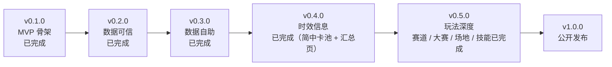

# 开发计划

本文档是功能排期与技术债的单一来源。`README.md` 说明"现在是什么"，`docs/` 说明"为什么这样设计"，本文档说明"接下来做什么、做到什么程度算完成"。

- 当前版本：`v1.0.0`；**功能进度**：P0–P3 全部完成，**P4 发布包装完成**（打包 / CI artifact / 运行时落点 / 首次引导 / 仓库模板 / 合规说明）
- 目标形态：Windows 桌面应用，本地运行、数据可追溯、功能按模块增量交付
- 优先级原则：**数据可信 > 数据自助 > 时效信息 > 玩法深度 > 发布包装**

## 当前状态

### 已交付

| 能力 | 落点 | 验证方式 | 状态 |
| --- | --- | --- | --- |
| 应用内核（配置 / SQLite / 数据版本） | `app/kernel/` | `tests/test_system.py` | ✅ |
| 模块系统（发现 / 依赖排序 / 隔离加载 / 生命周期） | `app/kernel/modules.py` | 启动日志 + `/api/system/modules` | ✅ |
| 桌面壳（端口探测 / 就绪轮询 / pywebview 窗口） | `app/desktop.py` | 实际弹窗 + `/api/health` | ✅ |
| 前端壳（侧栏 / hash 路由 / 数据版本徽标 / 面板动态加载） | `static/` | 浏览器实测三个页面 | ✅ |
| 图鉴模块：master.mdb → SQLite 导入 | `modules/catalog/importer.py` | 两份真实 mdb 端到端（日服 / 简中服快照） | ✅ |
| 真实 `master.mdb` 字段映射验证 | `modules/catalog/importer.py` | 日服快照 111 育成卡 / 262 协助卡 / 731 技能 / 42462 文本；简中服 2026-10 快照 161 / 362 / 1289 / 61801；两份 `skipped` 与 `missing_columns` 均为空 | ✅ |
| 从本机客户端提取当期数据 | `modules/sync/android.py`（CLI：`scripts/fetch_mdb_android.py`） | 自动定位 adb 与实例 → 校验包名 / root / SQLite 结构 → `adb pull` → 打印 sha256 并比对本地库；`--check` 只比对不写。实测从 MuMu（2.0.2）取到 2026-10-22 快照并重导，`tests/test_fetch_mdb.py` 覆盖 | ✅ |
| 简中服官方术语表（从快照 `text_data` 提取） | `docs/kb/08-glossary.md` | 协助卡 / 耐力 / 领跑·跟前·居中·后追 / 群英联赛 / 解锁上限 / 干劲五档 / 赛事等级 | ✅ |
| 图鉴模块：马娘 / 协助卡 / 技能检索 | `modules/catalog/service.py` | `tests/test_catalog.py` | ✅ |
| 图鉴详情视图（可读属性 + 完整描述 + 数据版本） | `modules/catalog/ui/panel.js`、`modules/catalog/labels.py` | 浏览器实测点击 / Enter / Esc / 点遮罩；`tests/test_catalog.py` 断言属性与版本 | ✅ |
| 协助卡突破表与固有加成（含发动条件） | `modules/catalog/service.py`、`modules/catalog/ui/panel.js` | `support_card_limit` 决定 R/SR/SSR 各档上限（20/25/30/35/40、25/30/35/40/45、30/35/40/45/50）；面板给「效果 × 0–4 突」五列，固有加成单独一块并用 `text_data` 155 的原文写出条件型加成（101–120）的发动条件；`tests/test_catalog.py` 断言档位换算、字典优先与解锁档 | ✅ |
| 导入失败的可诊断性 | `modules/catalog/importer.py` | 缺文件 / 目录 / 非 SQLite / 缺 `text_data` 四类均有中文单测；CLI 退出码 `2` | ✅ |
| 文件日志（`data/logs/app.log`，1 MB × 3 轮转） | `app/kernel/logging.py` | `tests/test_logging.py`；实际启动后日志含 uvicorn 与模块输出 | ✅ |
| 知识库模块：文档上传 / 切块 / 向量检索 / 带引用回答 | `modules/knowledge/` | 上传 md → 检索命中 → 删除 | ✅ |
| 数据同步模块：设备提取 / 上传 / 幂等 / 快照历史 | `modules/sync/` | `tests/test_sync.py`（13 例）；面板内嵌在概览「数据版本」卡（`[ui] hidden = true`，不进侧栏），浏览器实测「检查客户端」与上传 | ✅ |
| 内置机制知识库素材（11 篇，带来源 / 版本 / 可信级别） | `docs/kb/` | 导入 11 篇 → 165 个切块；新增 BWiki 来源（状态效果、赛事名称、相性算法、赛道几何）与「数据版本与更新流程」（kb README 3.4） | ✅ |
| 活动 / 卡池 / 日程（BWiki SMW 抓取 + 差异审计 + 日程面板） | `modules/events/` | `tests/test_events.py`（25 例）；真实抓取 202 条简中服卡池；浏览器「日程」页实测 | ✅ |
| **日程汇总页**（卡池排期 + 大赛排期 + BWiki 时间轴同页；大赛默认只看未结束） | `modules/events/ui/panel.js` | 浏览器实测：41 条未来卡池 / 22 条进行中 / 大赛 2 届（取消勾选 29 届） | ✅ 2026-10-27 |
| 知识库问答（文档检索 + 结构化数据优先） | `modules/knowledge/`（`structured.py`） | `tests/test_knowledge_structured.py`（15 例）；实测「这届大赛的赛道终直」「加快步伐的技能条件」「现在有什么卡池」均命中结构化数据 | ✅ 2026-10-28 |
| 界面收口（卡片网格 + 长列表折叠 + 内容限宽） | `static/app.js`（`createLimiter`）、`static/styles.css` | 六页实测无横向滚动；卡池首屏 6 条、技能 9 条三列、赛道 9 条三列、图鉴 9 条三列 | ✅ 2026-10-27 |
| 卡池预告模块（`gacha_data` 排期 + 精选 + 未来卡池 + 未定档识别） | `modules/gacha/` | `tests/test_gacha.py`（10 例）；真实库 348 个卡池 / 41 个未来 / 3 个未定档；面板并入「日程」 | ✅ 2026-10-27 |
| 技能库（条件表达式 + 效果参数 + 反查马娘 / 协助卡 + 进化关系） | `modules/skills/` | `tests/test_skills.py`（15 例）；1289 技能 / 1450 槽位 / 1895 效果 / 345 进化 | ✅ 2026-10-27 |
| 相性查询（两人关系组点数 + 六人继承布局） | `modules/succession/` | `tests/test_succession.py`（13 例）；真实库 2133 关系组 / 4527 成员 / 95 角色；特别周 × 无声铃鹿 = 27 分 △、六人布局示例 91 分 〇 | ✅ 2026-10-28 |
| 赛道几何「切线」口径（首段未列出的开场直线） | `modules/races/geometry.py` | 107 条几何中 12 条带切线，`opening_straight` 入库；`tests/test_races.py` 断言 |
| 赛事目录与赛道几何（mdb 赛事 1525 场 + BWiki 赛道 107 条分段 / 坡道） | `modules/races/` | `tests/test_races.py`（24 例）；真实刷新 `races=1525 / courses=121 / geometry=107`，4 条源数据缺陷出告警；6 条示例赛道与知识库一致 | ✅ |
| 知识库素材重复导入的覆盖语义 | `scripts/import_kb.py` | 同名素材内容变化时先删旧版本再导入（`--keep-stale` 可关闭） | ✅ |
| 模块脚手架 | `modules/_template/` | 复制即用 | ✅ |
| 一键启动（`start.cmd` + `scripts/launch.ps1`） | 根目录 / `scripts/launch.ps1` | 定位 uv → 按需 `uv sync` → 启动；uv 缺失时回退 `.venv`，两者都不可用时以退出码 2 给出安装指引；四条分支均实测 | ✅ |
| 规范（代码 / 提交 / PR / 模块清单） | `CONTRIBUTING.md` | — | ✅ |
| Agent 定制（项目 instructions + 4 个 skills） | `.github/instructions/`、`.github/skills/` | 让 Agent 记住模块约定、数据口径、验证流程 | ✅ 2026-10-27 |
| CI（ruff check + format check + pytest） | `.github/workflows/ci.yml` | — | ✅ |
| **打包（PyInstaller 精简版 45.3 MB / 完整版 691.1 MB + 冒烟脚本）** | `packaging/` | `packaging/smoke.ps1` 实测：冷启动 2.6 s 就绪、`frozen=true`、数据落 `%LOCALAPPDATA%`、8 个模块全 `ok`；CI 出 zip artifact | ✅ 2026-10-28 |
| 运行时文件落点（源码写项目内、打包写 `%LOCALAPPDATA%`） | `app/kernel/config.py` | `tests/test_config.py` 覆盖两种形态与 `%LOCALAPPDATA%` 缺失回退 | ✅ 2026-10-28 |
| 首次使用引导（无数据时的三步卡片） | `static/app.js`、`/api/system/info` 的 `setup` | `tests/test_system.py` 断言首次运行与导入后翻转 | ✅ 2026-10-28 |
| 开源仓库模板（Issue 表单 / PR 模板） | `.github/ISSUE_TEMPLATE/`、`.github/PULL_REQUEST_TEMPLATE.md` | — | ✅ 2026-10-28 |
| 数据合规说明（来源 / 不分发范围 / 离机路径） | `docs/data-policy.md` | — | ✅ 2026-10-28 |

### 已知缺口

| 缺口 | 影响 | 归属阶段 |
| --- | --- | --- |
| 技能完整清单、效果数值、发动条件 | 不能查具体技能的效果值与触发条件 | ✅ P3-3（2026-10-27）：侧栏「技能」可查 1289 个技能的条件与效果原始值，并反查马娘 / 协助卡来源与进化关系；`ability_type` 等编号仍无字典表 |
| 协助卡训练加成与固有加成的语义 | ~~只能看卡面文字，不能按突破等级算~~ | ✅ 2026-10-27：图鉴详情给出 `support_card_effect_table` 的初始值、各突破等级值与上限，以及 `support_card_unique_effect` 的两个固有加成槽位；效果名称取自 BWiki（主数据无字典表），见 [docs/catalog.md](docs/catalog.md) |
| ~~数据导入只能跑命令行~~ | 已解决：侧栏「数据同步」页可检查客户端、一键导入或上传文件 | P1 ✅（2026-10-26） |
| ~~无活动 / 卡池 / 日程数据~~ | 已解决：侧栏「日程」由 BWiki 抓取**简中服**卡池（繁中 / 日服来源已下线），并汇总 `master.mdb` 的卡池排期与大赛排期 | P2 ✅（2026-10-26）；汇总 2026-10-27 |
| ~~日服节奏的活动无法自动折算成简中服日期~~ | 已按需求不再跟踪：日服「活动」分类随日服来源一起删除，模块现在只管简中服卡池 | 不做（2026-10-27） |
| 数据更新的上限受客户端约束 | 客户端未更新时，本地库只能停在上一版；「实时最新」取决于游戏是否已推新数据 | 已尽量收紧（2026-10-26）：`modules/sync` 可一键从本机 MuMu 客户端提取当期 mdb 并比对 sha256，本地库为 `mdb-cn-20261022`（2.0.2，161 / 362 / 1289 / 61801）。仍无法绕过游戏本身不更新的情况 |
| ~~无赛道数据~~ | 已解决：侧栏「赛道」可查 1525 场比赛与 107 条赛道几何（分段 / 坡道 / 终直），14 条地方场地无几何并明确标注 | P3-1a ✅（2026-10-26） |
| 大赛（CM）排期与轮次赛道 | ~~数据在 mdb 里但还没有界面~~ | ✅ P3-2（2026-10-26）：排期 + 轮次窗口 + 晋级门槛；2026-10-27 起入口在「日程」页，默认只看未结束 |
| 天气 / 马场状态的**数值**修正（对速度、加速度、耐力消耗） | 只有出现率，没有修正系数；来源里没有官方公式 | 已知缺口，不自行推导（P3-1b 只给出现率） |
| 卡池 `type` / 技能 `ability_type` 等枚举的中文含义 | 主数据没有字典表，面板只回显「类型 N / 原始值 N」 | 需要外部资料确认，不猜 |
| 卡池概率与消耗（`gacha_odds` / `cost_single`） | 面板不展示概率与付费信息 | 商业内容，需单独确认口径（P3-4 之后评估） |
| 大赛对手阵容与环境使用率 | 只有赛制、赛道与晋级门槛，没有当届玩家环境 | 已知缺口，需外部统计数据 |
| 相性里的适性契合度 | `succession_relation*` 只覆盖关系组；适性（马场 / 距离 / 跑法）在主数据里没有表 | 已知缺口，`succession` 明确声明不含 |
| 育成收益数值（训练菜单产出） | 不做育成规划后不再是需求；原始表仍留在 mdb，需要时可直接查 | 不做（见「不做的事」） |
| 未打包成 exe | 首次运行仍需装 Python 与 uv（`start.cmd` 之后无需敲命令，但仍依赖环境） | P4 |
| ~~仓库未初始化 git~~ | 已执行：分支保护、Issue/PR 模板仍待 P4-4 | P0-6 ✅ |

## 版本节奏

每个版本必须满足：`ruff check`、`ruff format --check`、`pytest` 全绿，且 `README.md` 的模块一览表与实际模块一致。

## Agent 定制（2026-10-27）

项目内自带一份项目 instructions + 四个 skill，让 Agent 少踩坑；用户提需求时优先引用：

| 位置 | 内容 | 用途 |
| --- | --- | --- |
| `.github/instructions/uma-assistant.instructions.md` | 项目规则（`applyTo: uma-assistant/**`）：命令、模块七件套、数据来源纪律、BOM 陷阱、前端约定、测试约定、运行时数据 | 改这个仓库的任何文件时自动生效 |
| `.github/skills/uma-requirement/` | 需求 → 可验收任务拆解（复述、事实核查、影响面、验收标准、口径边界） | 用户用口语提需求时自动加载 |
| `.github/skills/uma-module/` | 新增 / 改造模块的七件套与文档清单 | 写新模块或搬面板时 |
| `.github/skills/uma-data-probe/` | `master.mdb` / BWiki 探查模板与核实清单 | 决定「这个数据能不能用」时 |
| `.github/skills/uma-verify/` | lint / pytest / 重启 8742 / 浏览器验收 / 一致性检查 / 汇报格式 | 交付前 |

维护要求：改了模块契约、数据口径或验证命令时，**同步改这几份文件**，否则它们会变成过期文档。

## P0 — 数据可信（v0.2.0）

**目标**：证明"读到的数据和游戏里看到的一致"。在此之前不做任何新功能。

| ID | 任务 | 验收标准 | 依赖 | 状态 |
| --- | --- | --- | --- | --- |
| P0-1 | 用真实 `master.mdb` 跑一次导入 | `skipped` 为空；三类条目计数与源库一致；抽查名称与描述完全匹配 | — | ✅ 日服快照 111/262/731/42462，简中服快照 47/154/446/22425，抽查 `特别周` / `[特别追梦者]` / `小心波澜炮！` 均匹配 |
| P0-2 | 校正 `text_data` 分类映射 | 确认真实结构并写进常量注释 | P0-1 | ✅ 实测 `id == category`，实体 id 在 `"index"`；已验证类别 4/5/6/47/48/63/75/76 等 |
| P0-3 | 补列缺失的诊断能力 | `ImportSummary` 增加 `missing_columns: dict[str, list[str]]` | 无 | ✅ 两份真实快照均为空，合成 fixture 可复现上报 |
| P0-4 | 图鉴详情视图 | 点击列表项展开详情（完整描述、天赋加成、稀有度可读化）；详情显示数据版本；键盘可关闭 | 无 | ✅ 列表行可点击/可聚焦（Enter 打开），`<dialog>` 详情展示可读属性、`pre-wrap` 完整描述、条目 ID 与数据版本脚注；Esc 与点遮罩关闭；`labels.py` 集中枚举映射，未收录取值回显「原始值 N」 |
| P0-5 | 导入失败的可诊断性 | 文件不存在 / 非 SQLite / 缺 `text_data` 时给出明确中文错误，而不是堆栈 | 无 | ✅ 三类失败统一抛 `MasterMdbError`（中文、带实际表名与常见成因）；CLI 只打一行原因 + 日志路径，退出码 `2`；单测覆盖缺文件 / 目录 / 非 SQLite / 缺表 |
| P0-6 | git 初始化与首次提交 | 按 `CONTRIBUTING.md` 的提交规范建立 `main` 与首个 commit | 无 | ✅ 2026-10-28：`main` + 首个 `chore(repo)` 提交 + `v0.1.0` 标签；提交前跑通 `ruff check` / `format --check` / `pytest`（149 例），`.env`、`data/`、`*.mdb`、`.venv/` 均未入库 |
| P0-7 | 日志落文件 | 日志写 `data/logs/app.log`，按大小轮转保留 3 份 | 无 | ✅ `app/kernel/logging.py`：`RotatingFileHandler` 1 MB × 3，控制台 + 文件双通道；`app.desktop` 与 `import_master_mdb` 均已接入，uvicorn 日志（`log_config=None`）同样落盘 |

**P0 完成标志**：能用真实数据在图鉴里搜到任意一个马娘，点开看到正确的技能描述与天赋加成。

## P1 — 数据自助（v0.3.0）

**目标**：把"跑命令行"变成"点一下"，并让数据版本真正可追溯。

| ID | 任务 | 验收标准 | 依赖 | 状态 |
| --- | --- | --- | --- | --- |
| P1-1 | 新建 `modules/sync` 模块 | manifest + `setup(ctx)`；`uv run python -m app.desktop` 后侧栏出现"数据同步" | P0 | ✅ 模块 `status: ok`，`/api/sync/status` 与侧栏「数据同步」均通 |
| P1-2 | `POST /api/sync/mdb` | 传入本机路径即可导入；成功后 `/api/system/info` 的数据版本立即变化 | P1-1 | ✅ 另有 `/upload`（multipart）与 `/android`（设备提取） |
| P1-2b | 复用 `scripts/fetch_mdb_android.py` 的提取逻辑（把 adb 探测/校验搬到 `modules/sync`，CLI 保留薄封装） | 应用内能直接从模拟器取当期 mdb，不必让用户自己翻 `data/data` 目录 | P1-1 | ✅ 逻辑在 `modules/sync/android.py`；面板「检查客户端」实测识别 MuMu 2.0.2 并判定「与本地库一致」 |
| P1-3 | 版本探测与幂等 | 同一文件重复导入时按 sha256 跳过并提示"已是最新" | P1-2 | ✅ `apply_path()` 比对 `meta.data.source`，跳过时不写库不记快照；`force` 可强制 |
| P1-4 | 快照与历史 | 每次导入写 `data/snapshots/<version>.json`；`GET /api/sync/history` 可列出 | P1-2 | ✅ 快照含 sha256 / 数据集 / `via` / 设备信息；缺记录时按 meta 补记（`backfilled`） |
| P1-5 | CLI 退化为薄封装 | `scripts/import_master_mdb.py` 只调用 `sync.service`，无重复逻辑 | P1-2 | ✅ 两个脚本都不再含导入或 adb 逻辑，只做参数解析与打印 |
| P1-6 | 同步面板 | 选文件、看进度、看历史、看当前版本；失败时显示原因而非白屏 | P1-2 | ✅ `modules/sync/ui/panel.js`：版本卡 / 检查并导入 / 文件上传 / 历史列表；失败显示后端中文原因 |

**P1 完成标志**：不打开终端，仅在应用内完成一次数据更新，并能查到"这版数据是什么时候、从哪来的"。

> 2026-10-26：P1-1 ~ P1-6（含 P1-2b）全部完成。侧栏「数据同步」页可「检查客户端 → 导入这一版」或上传文件；每次导入写 `data/snapshots/<版本>.json`，`/api/sync/history` 可列出；CLI 两个脚本已退化为薄封装。验证：`tests/test_sync.py` 13 例、`tests/test_fetch_mdb.py` 8 例，全量 46 例；浏览器实测「检查客户端」识别 MuMu 2.0.2 并判定「与本地库一致」，上传同版文件返回「未重复导入」；空库实例下「导入这一版」成功并即时刷新侧栏版本徽标（`ctx.refreshInfo()`）。

## P2 — 时效信息（v0.4.0）

**目标**：补上 mdb 里没有的活动、卡池、日程。

| ID | 任务 | 验收标准 | 依赖 | 状态 |
| --- | --- | --- | --- | --- |
| P2-1 | BWiki 抓取层（`Fetcher` 协议 + 缓存 + 限速） | 串行、间隔 ≥1s、带 `If-None-Match`；单测注入假响应 | P1 | ✅ `modules/events/fetcher.py`：串行限速 1.5s、`If-None-Match`、429/5xx/567 退避重试、HTML 反爬页识别、离线降级用缓存并标 `stale`。BWiki 实测不回 ETag，故另加 6h TTL 缓存 + `force` 绕过 |
| P2-2 | 活动 / 卡池数据结构 | 新表 `events_*`，每条带 `source_level`（A/B/C/D）与 `fetched_at` | P2-1 | ✅ `events_items` / `events_fetches` / `events_changes`；服务器只由 BWiki 分类决定（`简中*` / `繁中*` / 其余=日服），占位与无时间条目降 D 级 |
| P2-3 | 抓取任务与差异展示 | 只对变化的行写审计；UI 显示"新增/变更/移除"条数 | P2-2 | ✅ `diff_items()` 按 `COMPARED_FIELDS` 比对，二次刷新 `added/changed/removed` 全 0；面板「最近变更」显示条数 |
| P2-4 | 来源角标 | B 级及以下数据在 UI 上显示来源标记 | P2-3 | ✅ 每条带服务器（简中/繁中/日服）、等级（A–D）、原文链接与抓取时间 |
| P2-5 | 日程面板 | 按时间排列的活动 / 卡池，今天与本周高亮 | P2-2 | ✅ 侧栏「日程」：来源卡 + 时间轴（正在进行 / 即将开始 / 时间未定 / 已结束），今天与本周加色条 |
| P2-6 | 简中术语人工校对 | `docs/kb/08-glossary.md` 的「核实状态」列全改为「已核对（来源 + 日期）」；知识库检索结果中的中文措辞与简中服 UI 一致 | — | ✅ 已用简中服 mdb 文本表核对，8 篇正文与 UI 文案已统一 |
| P2-7 | 知识库缺口回归 | `docs/kb/README.md` 的缺口表每条要么有结论、要么仍标注「未覆盖」；新增事实必须带来源 URL 与抓取时间 | P2-6 | ✅ 2026-10-26：新增 S8/S9 BWiki 来源与 09/10 两篇；缺口表逐条标注「已补 / 部分覆盖 / 未覆盖」，并区分日服与简中服页面 |

**P2 完成标志**：打开应用能看到当前卡池与近期活动，并知道这些信息来自哪个页面、什么时候抓的。

> 2026-10-26：P2-1 ~ P2-5 完成。新增 `modules/events/`，经 BWiki MediaWiki `api.php` 的 SMW `action=ask` 抓 6 个来源（简中 / 繁中 / 日服各卡池 + 日服活动），真实抓取 529 条入库（卡池 430 / 活动 99；简中 202 / 日服 327）。侧栏「日程」按 正在进行 / 即将开始 / 时间未定 / 已结束 分组，今天与本周高亮，每条带服务器、来源等级、原文链接与抓取时间；刷新按钮走 `force=true` 绕过 6h 缓存。**服务器甄别只依分类**（`简中赛马娘卡池`/`简中支援卡卡池`=简中服，`繁中*`=繁中服，`赛马娘卡池`=日服）；「活动」分类是日服节奏（JST），故繁中来源默认不启用，避免把日服节奏当繁中服。验证：`tests/test_events.py` 18 例、全量 65 例；浏览器实测来源卡 6 条、时间轴 12 行、角标与「今天」高亮均正确。
>
> 2026-10-27：日程新增「近期提醒」卡与 `near_term` 汇总，回答「有什么要开始 / 什么快结束」。`upcoming`（未来开始，按开始时间）与 `ending_soon`（`active` 且剩余 ≤ `UMA_EVENTS_NEAR_DAYS`，默认 7 天，按结束时间）各列最多 5 条，带 `days_to_start` / `days_left`；时间轴的「即将开始」组即使为 0 也会显示并说明原因。**核实结论**：BWiki 分类页只收录**已经开始**的卡池与活动——2026-10-27 的库内 529 条里最晚 `starts_at` 是 2026-10-26 12:00（JST），未来条目为 0，所以「即将开始」为空是数据现状而不是漏抓，简中服下一期卡池要等官方公告与页面更新后再刷新。测试 107 → 109 例。
>
> 2026-10-27：来源里的**占位行**（`无马娘卡池，占位用 20261020` 这类，标题含「占位 / 待补充 / 敬请期待」）不再污染日程：仍按 D 级入库但不进时间轴与「近期提醒」，`counts.placeholders` 报出隐藏条数，面板加了「显示占位条目」开关可按需放回。**不删库内数据**——删了既无法核对来源确实没有内容，下次抓取也会重新写回。测试 109 → 110 例。
>
> 2026-10-27：**图鉴详情补全**。详情弹窗不再只有名字与描述：马娘显示**技能组**（`card_data.available_skill_set_id` → `available_skill_set.available_skill_set_id`，带 `need_rank` 解锁星级），协助卡显示**训练效果表**（`support_card_effect_table` 的 `init` 与 `lv5..lv50`，`-1` 表示该档不提升）、**固有加成**（`support_card_unique_effect` 两个槽位）与**提示技能**（`single_mode_hint_gain` 的 `hint_gain_type = 0`）。新增 4 张表 `catalog_character_skills` / `catalog_support_effects` / `catalog_support_unique` / `catalog_support_skills`，真实库导入 1113 / 3120 / 516 / 2296 条。**效果类型没有主数据字典**，名称取自 BWiki「支援卡效果一览」revid 35946（2026-10-27 抓取，ID 1–31），写进 `labels.py` 并在详情里标注来源，31 以外只显示「原始值 N」。文档新增 [docs/catalog.md](docs/catalog.md)，ROADMAP 的「协助卡加成」缺口同步标为解决。测试 121 → 121 例（`test_catalog.py` 扩表并断言技能组、突破等级、无字典类型回显）。
>
> 2026-10-27：**卡池预告改为从 mdb 取**，新增 `modules/gacha/`（`gacha_catalog` + `gacha_pickups`、4 个接口、侧栏「卡池」）。查证结论：`gacha_data` 有 `start_date` / `end_date`（unix 秒），348 个卡池里 **44 个在未来**、最晚 2027-01-18；名称与说明在 `text_data` 26 / 13（348/348），精选在 `gacha_available.is_pickup = 1`（马娘卡 1858/1858、协助卡 1734/1742 能解析出名字）。**交叉验证**：`gacha_data.id=30204` 的排期与精选「跳舞城[GLITTER！]」和 BWiki 简中服当期卡池逐字一致，`30203` 与「超稀有万籁争鸣、稀有极峰 协助卡招募」的起止时间也一致——所以客户端内置排期就是简中服实际排期，此前「卡池预告只能接公告源」的判断被推翻。`gacha_data.type` 无字典表，只回显「类型 N」；常驻池（跨度 > 5 年，如新人出道写到 2050 年）标「常驻」。大赛预告本来就由 `races.champions` 提供（未来 2 届）。测试 110 → 119 例。
>
> 2026-10-27：卡池页修正 2050 哨兵语义。`gacha_data` 里有 23 条远期记录：其中 20 条把 `end_date` 写成 `2050-01-01` 表示「不结束」（新人出道 / 通用招募，标「常驻」、显示「记录结束时间 2050-01-01」）；另外 3 条（`30130` / `30131` 起止都在 2050-10、`20013` 从 2049-12-28 起）是**未定档占位**，此前被算成「即将开始」于是显示「还有 8800 天」。现在 `SENTINEL_TS ≈ 2049-03-22` 统一判定：`start_date` 越过哨兵 → `unscheduled`，单独列在「未定档（占位）」卡里并说明不是真实排期；导入统计的「未来卡池」也排除它们（44 → 41）。测试 119 → 120 例。
>
> 2026-10-27：**日程合并为时间总页**。按「时间相关的东西应该在一页」的取舍：删掉独立的「卡池」导航页（`gacha` 的 `manifest.toml` 去掉 `[ui]`，只留 `/api/gacha`），把卡池排期卡、大赛（群英联赛）卡一起搬进「日程」；「大赛」从「赛道」页移出，「赛道」页只留赛道几何与场地状态、并在来源卡注明「大赛排期在『日程』页查看」。大赛卡**「只看未结束」默认勾选**（2 届，取消后 29 届）。跨模块只走 HTTP，`events` 的 `requires` 加 `gacha`/`races` 保证加载顺序；任一接口失败时该卡降级成一行提示，BWiki 时间轴不受影响。顺带修了侧栏把「无面板模块」也列出来的问题（`renderSidebar` 过滤 `ui.panel`）。
>
> 2026-10-27：**日程只跟简中服**。按需求删除繁中服（`tw-character-pool` / `tw-support-pool`）与日服（`jp-character-pool` / `jp-event`）四个来源的代码：`sources.py` 的 `SOURCES` 只剩 `简中赛马娘卡池` / `简中支援卡卡池`，`SERVER_LABELS` / `SERVER_ZONES` 只保留 `cn`（`JST` 常量一并删除），`UMA_EVENTS_SERVERS` 默认 `cn`；面板的服务器筛选按钮整块移除。**库内旧数据也要清**：新增 `store.purge_sources()`，刷新时删掉不再配置的来源的 `events_items` / `events_changes` / `events_fetches`（与「来源消失只软删」不同，这是配置层面下线）。真实库实测 529 条 → **202 条**（279 条日服 + 繁中数据与 99 条日服活动一并清掉），`by_kind` 只剩 `pool`。测试 120 → 121 例（跨服用例改写为「只剩 cn」与「刷新会清理旧来源」）。
>
> 2026-10-27：**界面收口，去掉超长单列列表**。`static/app.js` 新增 `createLimiter(n)`（`ctx` 里可直接用）负责「首屏 6–9 条 + 展开其余 N 条」；`styles.css` 加 `#view { max-width: 1180px }`、`.list.grid`（`repeat(auto-fill, minmax(300px,1fr))`，宽屏 2–3 列）、`.meta.clamp`（两行截断）、`.more-btn`；`nowrap` 角标在网格内自动放开，修掉 1px 横向滚动条。六个面板都接上：日程（卡池 41 → 首屏 6、时间轴分组、最近变更 20 → 6、来源清单收进 `
`）、技能（100 条 → 9，三列）、赛道（121 条赛道 / 50 场赛事 → 9，三列）、图鉴（搜索结果 9 条三列 + 两行截断）、知识库（文档 6 条）、数据同步（历史 6 条）。实测各页 `.main-scroll` 无横向滚动，卡片高度从「一列长条」变成 84–126px。约定写进 `docs/architecture.md` 的「前端约定」与项目 instructions。

## P3 — 玩法深度（v0.5.0）

**目标**：从「查得到」进到「算得出」。这一阶段的每条结论都要落到具体表、具体行与数据版本；LLM 只负责组织语言，不负责产出事实。**不做育成规划**（属性分配 / 回合计划 / 训练侧重建议），理由见「不做的事」。

数据依据全部在本机 `master.mdb`（A 级），行数为 2026-10-22 简中服快照实测：

| 表 | 行数 | 用来回答什么 |
| --- | --- | --- |
| `champions_schedule` / `champions_round_schedule` / `champions_round_detail` / `champions_race_condition` | 29 / 174 / 406 / 203 | 大赛起止、轮次时间窗、晋级门槛、每轮赛道 |
| `race` / `race_course_set` / `race_instance` | 1819 / 121 / — | 赛事、赛道路线、赛事实例 |
| `race_condition` | 67 | 场地状态出现率：`rate` 按 `(area, season)` 分组恒等于 `100000000` |
| `skill_data` / `available_skill_set` / `single_mode_hint_gain` | 1289 / 1113 / 3058 | 技能前置条件、效果参数、马娘来源、协助卡提示来源（`hint_gain_type = 0` 的 2296 行） |
| `card_data` / `support_card_data` | 161 / 362 | 技能反查的两个入口（1113 / 362 有可连接的 id）；`skill_set` 链路退化，未采用 |
| `support_card_effect_table` / `support_card_unique_effect` | 3120 / 258 | 协助卡的训练加成（按突破等级）与固有加成 |
| `succession_relation` / `_member` / `_rank` | 2133 / 4527 / 3 | 相性点数与等级阈值（0–50 / 51–150 / 151+） |

| ID | 任务 | 验收标准 | 依赖 | 状态 |
| --- | --- | --- | --- | --- |
| P3-1a | 赛道模块 | 结构化查询：赛事目录、赛道分段、坡道、终直；不依赖 LLM 也能给出正确答案 | P0 | ✅ `modules/races/`（6 个接口 + 面板，1525 场 / 121 条赛道 / 107 条几何） |
| P3-1b | 马场状态出现率 | 同一 `(area, season)` 下 良 / 稍重 / 重 / 不良 与 晴 / 阴 / 雨 / 雪 的组合出现率之和为 100%；面板写清「这是出现率，不是速度或耐力修正系数」 | P3-1a | ✅ `race_condition` 67 行入库为 `races_conditions`；`/api/races/conditions` 按区组 + 季节返回 `percent`；面板「场地状态出现率」卡，默认展示大赛引用的 999 表 |
| P3-2 | 大赛（冠军大会）模块 | 列出 `champions_schedule` 的 29 场大赛及起止时间（UTC+8）；点进一场能看到「第 N 轮 → 赛道（场地 / 距离 / 方向 / 内圈外圈）→ 晋级门槛」；`race_condition` 给出该轮场地状态概率；**大赛名在 `text_data` 里取不到时显示「赛季 + 赛道」并标注名称缺失，不臆造** | P3-1a | ✅ `champions_*` 四表入库为 `races_champions*`；`/api/races/champions[/{id}]`；面板 2026-10-27 起在「日程」页的「大赛（群英联赛）」卡（默认只看未结束）。名称实际可取得（`race_instance → text_data` 32 =「群英联赛 金牛杯」），无需降级显示 |
| P3-3 | 技能库增强 | 技能详情能看前置条件与效果参数（`precondition_1` / `condition_1` / `ability_type_*` / `float_ability_*`）；`available_skill_set` + `card_data` 反查「哪些马娘有这个技能」，`skill_set` + `support_card_data` 反查「哪张协助卡给这个技能」；`skill_upgrade_speciality` 给出进化前后对应关系；**解析不了的字段显示原始值，不猜** | P0 | ✅ `modules/skills/`（1289 技能 / 1450 槽位 / 1895 效果 / 1113 马娘来源 / 2296 协助卡提示 / 345 进化）；`/api/skills/skills[/{id}]`；面板「技能」。**协助卡反查改用 `single_mode_hint_gain`**：`skill_set_id / 1000` 这条链路经核实退化（362 卡只落到 2 个组、7 个技能），不做逐卡映射 |
| P3-4 | 协助卡效果解析 | 任一张卡按突破等级（0 / 5 / 10 … 50）列出 `support_card_effect_table` 的每项数值与满破净增；`support_card_unique_effect` 按 `lv` 展开固有加成；卡面金技能可跳转 P3-3 详情；**`type` 的中文标签只写能核实的，核实不了的显示「类型 N」并标注待确认** | P3-3 | ✅ 图鉴详情：训练效果表（初始 / 各突破等级 / 满破 / **净增**）+ 固有加成（`need_lv` 解锁等级）+ 提示技能；技能行可点，跳到 `#/skills?skill=<id>` 打开 P3-3 详情。效果类型名取自 BWiki「支援卡效果一览」revid 35946（ID 1–31），31 以外回显「原始值 N」，见 [docs/catalog.md](catalog.md) |
| P3-5 | 相性查询 | 给两只马娘算出「共同关系组 → 点数合计 → 相性等级」；明确声明只覆盖 `succession_relation*` 的关系加成，不含适性与祖父母加权（后者见 KB 06，需用户输入） | P0 | ✅ `modules/succession/`（2133 关系组 / 4527 成员 / 95 角色 / 3 档区间）；`/api/succession/pairs` + `/layout`；面板「相性」。**另外实现了六人布局**（社区口径分槽累加，祖父母与目标同角色记 0），并在返回值里声明「不是官方公式、不含适性」；主数据无适性表（`%aptitude%` 查不到） |
| P3-6 | 知识库与结构化数据打通 | 问答先查库再检索文档：问赛道 / 大赛 / 技能时走结构化查询并标注来源表与数据版本；结构化数据缺失时回落 RAG 并标「来自文档，非当前数据」；两者冲突时都给出并说明取舍依据 | P3-2, P3-3 | ✅ `modules/knowledge/structured.py`：5 个话题（大赛 / 赛道 / 技能 / 卡池 / 图鉴）先调各模块接口，`ChatResponse.mode` 区分 `ok` / `structured_only` / `documents_only`，面板加「依据」块并列出 `misses`。见 [docs/knowledge.md](knowledge.md) |

**P3 完成标志**：给定一场大赛，能回答「跑哪条赛道、终直多长、当天场地状态概率、这条赛道适合什么跑法、需要哪些技能」，且每条结论都能指到具体表或页面与数据版本——但**不生成「怎么练」的作业**。

> 2026-10-28：**P3-6（知识库与结构化数据打通）完成**，P3 全部收口。`modules/knowledge/structured.py` 在检索前先查库：按关键词识别 5 个话题（大赛 / 赛道 / 技能 / 卡池 / 图鉴），**只走 HTTP 调各模块接口**（`UMA_KNOWLEDGE_STRUCTURED_BASE_URL`，默认内核 `host:port`），产出带「来源接口 + 涉及表 + 数据版本」的事实块塞进提示词首位；`ChatResponse.mode` 三态 `ok` / `structured_only` / `documents_only`。**三个口径决定**：① 话题顺序里 `champions` 在 `course` 之前，因为「这届大赛的赛道」要先用大赛记录里的 `course_id`；② 实体识别不靠分词 —— 赛道用库里赛场词表做最长匹配（带距离数字时按距离挑），技能/图鉴用 8→2 字滑动窗口查搜索接口、命中即停（上限 120 次本地调用）；③ 没配 `DEEPSEEK_API_KEY` 时若结构化命中就直接给事实清单（不再 503），两者都没有才报错。实测：「这届大赛的赛道终直多长」→ 大赛排期 + 赛道 10506（终直 300m / 直线 4 段 1104m / 含切线 100m）；「加快步伐这个技能的条件是什么」→ 技能 200462 的条件表达式与效果参数；「现在有什么卡池」→ 进行中 3 个 + 未开始 2 个。文档新增 [docs/knowledge.md](knowledge.md)。测试 134 → 149 例（`tests/test_knowledge_structured.py` 15 例）。
>
> 2026-10-28：**P3-4（协助卡效果解析）与 P3-5（相性查询）完成**。
>
> P3-4 落在图鉴详情里（`catalog`）：`support_card_effect_table` 的初始值 + `lv5..lv50` 各档 + 满破值 + **净增**，`support_card_unique_effect` 两个槽位（带 `need_lv` 解锁等级），`single_mode_hint_gain` 的提示技能；技能行可点，跳到 `#/skills?skill=<id>` 直接打开 P3-3 的技能详情（`static/app.js` 的 `route()` 现在支持 hash 查询参数，面板通过 `ctx.params` 读）。效果类型名在主数据里**没有字典**，取自 BWiki「支援卡效果一览」revid 35946（2026-10-27 抓取，ID 1–31），31 以外只显示「原始值 N」。新增 [docs/catalog.md](catalog.md)。
>
> P3-5 新增 `modules/succession/`：`succession_relation` 2133 组（点数只有 1/2/7/8）、`succession_relation_member` 4527 条、覆盖 95 名角色，`succession_relation_rank` 3 档（0–50 / 51–150 / 151+，与知识库 06 的 △/〇/⌾ 一致）。面板「相性」给两人相性（共享关系组卡片 + 连加式 + 等级）与**六人布局**（按社区口径分槽：1 号 f(0,1)、2 号 f(0,2)+f(1,2)、3/4 号 f(0,1,祖父母)、5/6 号 f(0,2,祖父母)，与目标同角色记 0）。**口径澄清三条**：① 关系组在主数据里没有名称字典，只显示编号与组内人数；② 两人点数之和 = 六人布局的 1 号位贡献，不是游戏内最终相性；③ 不含适性 —— 主数据里根本没有适性表（`%aptitude%` 查不到，`%proper%` 只有赛事侧出现率），所以「适性契合」这一项算不出来。实测：特别周 × 无声铃鹿 = 27 分（11 个共享组）/ △；六人布局（特别周 ← 无声铃鹿 / 东海帝王 + 1 位祖父母）= 91 分 / 〇。新增 [docs/succession.md](succession.md)。测试 121 → 134 例（`tests/test_succession.py` 13 例）。
>
> 2026-10-31：**应用图标**。用户给了一张 `Logo.png`，目标是打包后的 exe 图标就是它。改动：源图挪进 `packaging/Logo.png`；新增 `packaging/make-icon.ps1`（GDI+ 生成，不依赖 Pillow——`pillow` 在 dev 组声明但 `uv.lock` 未收录，`uv run` 会卡在重新解析依赖上），产出 `packaging/icon.ico`（16/24/32/48/64/128 用 32bpp BMP 帧 + 256 用 PNG 帧，共 7 帧）、`static/favicon.ico`（16/32/48）、`static/icon.png`（256）；spec 的 `EXE(icon=…)` 接上（非 Windows 平台不传，避免 CI 之外出错）；`index.html` 加 `rel="icon"` 与 `apple-touch-icon`；侧栏原来那个橙色 "U" 占位方块换成 34px 圆角品牌图。实测：`PyInstaller` 构建日志出现「Copying icon to EXE」，`ExtractAssociatedIcon` 取出的 32×32 与源图一致，exe 里能找到 256 帧的 PNG 签名；`packaging/smoke.ps1` 跑通（frozen=true、9 个模块 ok）；浏览器侧栏与 favicon 均生效。**已知**：pywebview 没有设置窗口图标的接口，源码模式（`uv run python -m app.desktop`）的任务栏图标仍是 Python 的，只有打包产物才是本图。
>
> 2026-10-31：**按钮风格统一**。原来 `styles.css` 只定义了 `button.primary` / `button.ghost`，另有 4 个裸 `<button>`（日程「刷新卡池排期」、赛道「重置 / 查询」、技能「查询」）直接吃浏览器原生灰样式；而且「刷新 X 数据」占着主操作色，真正的「查询」是灰的。现在：① `button` 有了基础规则（8px 圆角 / 8×16 内边距 / 13px / 描边次要态 / 统一 hover、`:disabled`、`:focus-visible`），`.ghost` 与之一致、只作语义标记，`.primary` 只换配色 + 悬停提亮；② 按「主操作 vs 次要操作」重新分档 —— 查询 / 计算 / 导入 / 提问 / 检查 = `primary`，刷新 / 重置 / 清空 / 关闭 / 删除 = 默认（日程两处刷新、赛道刷新与重置、技能刷新从 primary 降为次要，赛道 / 技能的「查询」升为 primary）；③ 选文件的 `.file-picker` 由虚线改实线，与旁边的「导入」并排时是同一个控件语言；④ 顺手修掉 status pill 在 flex 行里被压成竖排（「正/常」）的老问题（`.pill` 加 `white-space: nowrap; flex: none`）。七个页面逐个用 `getComputedStyle` 验过：动作按钮全部 8px / 13px，只剩胶囊形的 `.more-btn`（12px）与 `button.tag`（11px）两档轻量操作。约定写进 [docs/architecture.md](architecture.md) 的「前端约定」与项目 instructions。
>
> 2026-10-31：**日程页卡池的「+N」可以展开了**。必得 / 新春这类大杂烩池一行有几十张精选（快照里最多 68 张，`20013`「3★ WISH&GAZE 招募」），原来只列 4 张再挂一个死的 `+42` 标签，看不到剩下的。现在 `modules/events/ui/panel.js` 把 `+N` 做成按钮：点开显示全部、再点「收起」；展开状态存在 `expandedPickups`（按 `gacha_id`），所以勾选「显示最近已结束」或翻页重渲染后不丢。样式复用 `.tag`，只给 `button.tag` 补了 `font-family: inherit` 与 hover —— 标签外观不变但可点。
>
> 2026-10-31：**数据同步并进概览页的「数据版本」卡**。按「数据是几版、怎么换成新版」本来就该在一处：`modules/sync/manifest.toml` 的 `[ui]` 加 `hidden = true`（内核解析成 `ui.hidden`，`renderSidebar()` 一并过滤），面板保留、侧栏入口去掉；`static/app.js` 的 `renderOverview()` 把这张卡撑成 `
` + `
`，用新抽出的 `loadPanel()` / `panelContext()` 以 `embedded: true` 挂载 sync 面板。面板据此不渲染页面标题、也不再套一层卡片（用 `h3` 分块），保留「从本机客户端更新 / 从文件导入 / 历史快照」三块；`#/sync` 仍可直达完整版页面。导入成功后 `refreshInfo()` 除了刷新侧栏徽标还会 `patchOverviewVersion()` 就地重画这张卡，避免整页重绘冲掉「检查客户端」的结果。顺手把 10 行 `datasets` 条数折进「数据集条数（N 项）」，卡片一打开就能看到更新入口。
>
> 顺带补了两处既有缺口：`scripts/sync-agent-customization.ps1` 原本是 **0 字节空文件**（说明里却要求改完 instructions 就跑它），现在实现了 instructions + 4 个 SKILL 的镜像与 `-Check` 比对（实测：首次 `-Check` 报 5 个不一致、退出码 1 → 写入 → 再比对 0 个、退出码 0，且 4 个 SKILL 原本就已过期）；`.github/instructions` 里「没有 `[ui]` 不进侧栏」的规则补上 `hidden = true` 这条。测试：`tests/test_sync.py` 增断言 `ui.hidden is True`。
>
> 2026-10-31：**协助卡详情改成「突破表」，并核实效果类型与固有加成的发动条件**。原来把 `support_card_effect_table` 的 `init` 与 `lv5..lv50` 平铺成「初始 / 各突破等级 / 满破 / 净增」六列，看到的是等级档位而不是「突破一次能换到什么」。现在按 `support_card_limit` 折算成 **0/1/2/3/4 突五列**（R 20/25/30/35/40、SR 25/30/35/40/45、SSR 30/35/40/45/50，362 张卡无缺口；导入进新表 `catalog_support_limits`，旧库没有该稀有度时回落到 `labels.SUPPORT_LEVEL_CAPS`），每列是「突破到该档并练到该档等级上限」时的值（`-1` 取不超过该档上限的最近一档），去掉「类型」「净增」两列。
>
> **核实结论（推翻旧说法）**：效果类型在主数据里**有字典**——`text_data` 151 = 名称、154 = 说明（31 条，官方措辞「初始友情槽提升 / 比赛加成 / 擅长率提升 / 技能点数加成」与 BWiki 的「初期羁绊计量格提升 / 赛后加成 / 得意率提升 / 技能Pt加成」不同），155 = 固有加成的**成句文案**（258/258 命中）。**101–120 不是普通效果**，而是「满足条件才生效」的加成：`value_N` 是条件参数、`value_N_1..4` 是参数对/效果值，含义随类型变化（101 友情槽阈值 80/100、102 友情槽阈值且限非擅长训练、103 编成卡类型种数、104 粉丝数、106 友情训练次数上限、108/114 体力、118 友情槽 60 时可能出现在两处、120 按编成卡给属性……），主数据没有逐类型参数表，**因此只显示 155 的原文、不换算数值**；解锁等级 `lv` 换算成「等级 N · 第 X 突起可达到」，练不到时明说。
>
> 改动：新增 `catalog_support_effect_types` / `catalog_support_unique_text` 两张表，效果名改为字典优先（BWiki 只在老库缺 151 时兜底）；固有效果从突破表里挪出来单独一块（它不随突破变化，留在表里会变成 5 列同值），`/api/catalog/items/support_card/*` 新增 `unique` 块；知识库结构化块改用 `breakthroughs` + `unique`（上一轮删掉 `gain` 后它还在读，会打出「净增 None」）。顺带发现 `type_N = 0` 是空槽位（110 行 `type_1 = 0`、1 行 `type_0 = 0`，value 恒为 0），导入时跳过，固有加成 516 → 405 条。实测：SSR 30001 得意率 0 突（30 级）20 → 3 突（45 级）35；R 10001 上限 20/25/30/35/40 下友情加成 10 → 15；SSR 30081 显示「友情槽达到80时 / 训练效果提升 / 解锁条件：等级 40 · 第 2 突起可达到」。测试 154 → 156 例（`tests/test_catalog.py` 断言档位换算、字典优先、条件型不给数值、解锁档换算与上限兜底）。

> 2026-10-26：P3-1 的赛道部分完成，`races` 模块落地（详情见下）。
>
> 2026-10-27：P3-3 完成。新增 `modules/skills/`（六组 `skills_*` 表、4 个接口、侧栏「技能」）：`skill_data` 78 列里把条件表达式、`float_ability_time/cooldown`、`ability_type/value/target_*` 全部结构化，1289 技能 / 1450 槽位 / 1895 条效果参数。**口径澄清四处**：① 马娘反查必须 `card_data.available_skill_set_id = available_skill_set.available_skill_set_id`（用 `.id` 匹配 0 行）；② 协助卡反查只有 `single_mode_hint_gain`（`hint_gain_type = 0` 时 `hint_value_1` 即技能 id，2296 对 / 226 技能 / 340 卡），`skill_set_id / 1000` 这条链路 362 卡只解析出 2 个组（`9081` 覆盖 347、`9089` 覆盖 15）、合计 7 个技能且全被提示表覆盖，因此**不做逐卡映射**；③ `ability_type` / `target_type` / `skill_category` 在主数据里**没有字典表**（查遍全部表名与 `text_data` 全部类别），面板只回显「原始值 N」；④ `float_*` 没有单位声明，不换算。`mdb_mtime` 存进 `meta`，`master.mdb` 更新后启动自动补导入，避免同步新快照后技能表停在旧版。测试 92 → 107 例（`tests/test_skills.py` 15 例）。
>
> 2026-10-27：赛道几何新增「切线」。数据页常从第一个弯道开始记录（107 条里 12 条的 `lane[0].start > 2`），此前这段开场直线只记进 `unlisted_length`、不进直线段；现在补成 `name=切线`、`inferred=true` 的一段（长度另存 `opening_straight`），并计入 `straight_count` / `straight_total`，中段空档仍单列不补段（弯道之间省略的部分同样是直线，但没有位置信息能证明它连续）。**同期重新核实场地信息**：强制重抓数据页仍是 revid 142169（107 条 / 4 条告警 / 14 条无几何）；106 条几何总长与 mdb 距离完全一致，唯一偏差是 10613 的源数据缺陷（+448m）；赛场编码 101–115 用各场地赛事名交叉验证（大井 3 / 川崎 3 / 船桥 4 / 盛冈 4 / 隆尚 3），方向取值逐场地复核（东京·中京·新潟·川崎·盛冈·船桥 左，中山·京都·阪神·札幌·函馆·福岛·小仓·大井 右，新潟 1000m 与隆尚 1000m 为直线）。
>
> 2026-10-26：P3-1b 与 P3-2 完成。`races` 模块新增 `races_conditions`（`race_condition` 67 行，`rate` 按 `(area, season)` 分组恒为 1e8，用 `rate / 1e8` 当出现率）与 `races_champions` / `races_champion_rounds` / `races_champion_entries`（29 届 / 174 个窗口 / 406 条门槛），新增 3 个接口与两块面板卡。**口径澄清**：① 每届大赛只引用 1 条 `race_condition`，即该届固定的天气与马场（与 KB 04 一致），出现率只用于随机场景；② 大赛名其实取得到（`race_instance → text_data` 32），原先「名称缺失」的判断来自错查 `champions_schedule.resource_id`（那是资源 id）；③ `notice_date` 恒为 `-28800`，是时区偏移量不是时间戳；④ 天气与马场不是自由组合（雨只配重 / 不良，雪只在 `season 4`）。测试 84 → 92 例。
>
> 2026-10-26：新增 `modules/races/`：赛事目录来自 `master.mdb`（A 级，`race` + `text_data` category 32，1525 场，294 条无名称模板赛跳过），赛道登记来自 `race_course_set`（121 条，含无赛事引用的赛道），赛道几何来自 BWiki `Data:Course/jian data.json`（C 级，revid 142169，107 条分段 / 坡道）。侧栏「赛道」提供赛场 / 场地 / 方向 / 距离筛选、赛道详情（分段表终直高亮 + 坡道表 + 引用赛事 + 告警）与按赛事查。**几何统计口径明确化**：总长取末段 `end`（数据页分段不连续，用「首段 start + 各段 length」会在中山 1600m 这类记录上算出假偏差），直线段只数显式标出的段，未列出的空档单列 `unlisted_length`，与 mdb 距离比较留 2m 容差；告警从 10 条降到 4 条，剩余 4 条都是源数据缺陷（10613 越界、11102/11103/10907 相邻段重叠），原样保留。14 条地方 / 海外场地（川崎 / 船桥 / 盛冈 / 隆尚）没有简中几何，面板标「无几何」而不猜。验证：`tests/test_races.py` 16 例、全量 82 例；真实刷新 1525 / 121 / 107；6 条示例赛道与 `docs/kb/10-course-geometry.md` 逐项一致（并修正了该文里过时的「10301 只有一段直线」）。
>
> 2026-10-26 规划调整：**移除「育成规划（第一版）」（原 P3-4）**，不再排期。玩法深度改为「把 mdb 里已有的结构数据全部变成可查、可算的结论」，新增大赛（P3-2）、马场状态出现率（P3-1b）、相性查询（P3-5）三项，原 P3-2 / P3-3 / P3-5 顺延为 P3-3 / P3-4 / P3-6。

## P4 — 公开发布（v1.0.0）

| ID | 任务 | 验收标准 | 依赖 | 状态 |
| --- | --- | --- | --- | --- |
| P4-1 | 打包评估 | 评估 PyInstaller 体积（sentence-transformers 预计 2GB+），给出方案：体积裁剪 / ONNX / 可选组件 | P3 | ✅ 实测 `.venv` 1061 MB（torch 475 / scipy 93 / kubernetes 70 / chromadb 绑定 61 / transformers 55）；结论是**可选组件**：三个重依赖改成延迟导入 + spec 排除，精简版 45.3 MB。评估过但未采用的 ONNX / 全量方案写在 [docs/packaging.md](docs/packaging.md) |
| P4-2 | 打包与自动构建 | 产出单文件或安装包；CI 出 artifact | P4-1 | ✅ `packaging/uma-assistant.spec`（onedir 默认，`UMA_ONEFILE` / `UMA_BUNDLE_ML` / `UMA_CONSOLE` 三个开关）+ `packaging/smoke.ps1`；CI `package` 任务出 `uma-assistant-windows.zip`。实测精简版 45.3 MB / 770 文件，冷启动 2.6 s 就绪，8 个模块全部 `ok` |
| P4-2b | 运行时文件落点定稿 | 打包后决定 `data/` 与中转目录的最终位置（安装目录旁 / `%LOCALAPPDATA%`），业务代码只依赖 `Settings.data_dir` 与 `Settings.tmp_dir` | P4-2 | ✅ 落 `%LOCALAPPDATA%\uma-assistant\data\`（`.tmp` 在其下），只读资源走 `sys._MEIPASS`，`.env` 读 exe 同级；实现集中在 `config.py` 的 `is_frozen()` / `resource_root()` / `app_root()` / `default_data_dir()`，打包产物实测 `frozen=true`、数据目录为 `%LOCALAPPDATA%` |
| P4-3 | 首次使用引导 | 无数据时明确告诉用户下一步做什么，而不是空白界面 | P1 | ✅ `/api/system/info` 新增 `setup`（`first_run` / `mdb_present` / `can_import_via_ui` / `degraded_modules`）与 `paths`；概览页在首次运行时给出「导入数据 → 配置问答 → 查询」三步，可直接跳到「数据同步」；打包版不再提示源码里才有的 CLI 命令 |
| P4-4 | 开源仓库整理 | `LICENSE` / `CONTRIBUTING` / `docs` 齐备，Issue 与 PR 模板 | P0 | ✅ 新增 `.github/ISSUE_TEMPLATE/{bug_report,feature_request,config}.yml` 与 `.github/PULL_REQUEST_TEMPLATE.md`（模板里带「不贴游戏资源 / 不贴 key」的必勾项） |
| P4-5 | 数据合规说明 | 说清哪些数据来自哪里、哪些不分发 | P2 | ✅ [docs/data-policy.md](docs/data-policy.md)：来源清单（含可信级别与落点）、不分发范围、数据落点、唯一的离机路径（知识库问答发给 DeepSeek）、抓取礼节；README「合规边界」与 Issue 模板均链接过去 |

## 模块路线

| 模块 | 用途 | 数据源 | 依赖 | 阶段 |
| --- | --- | --- | --- | --- |
| `catalog` | 马娘 / 协助卡 / 技能查询 | 本机 `master.mdb` | — | ✅ v0.1 |
| `knowledge` | 攻略问答（RAG + LLM） | 用户文档 | — | ✅ v0.1 |
| `sync` | 数据更新与版本管理 | mdb / BWiki / 公告 | catalog | ✅ v0.3（mdb 部分） |
| `events` | 日程：简中服卡池抓取 + **卡池与大赛排期汇总页** | BWiki SMW（仅 cn）+ mdb（经 gacha / races 接口） | sync, gacha, races | ✅ v0.3 |
| `races` | 赛事目录、赛道几何、马场状态出现率、大赛排期 | mdb + BWiki 数据页 | catalog | ✅ v0.5（赛事 / 几何 / 出现率 / 大赛） |
| `skills` | 技能条件与效果、反查马娘与协助卡、进化技能 | mdb | catalog | ✅ v0.1（P3-3） |
| `succession` | 相性：两人关系组点数、六人继承布局分数与等级 | mdb | catalog | ✅ v0.1（P3-5） |
| `gacha` | 卡池排期（含未来卡池）、精选卡片、预告；面板并入「日程」页 | mdb | catalog | ✅ v0.1 |
| `support` | 协助卡加成（按突破等级）、固有加成、金技能 | mdb | catalog, skills | P3-4 |
| `succession` | 相性点数与等级 | mdb | catalog | P3-5 |
| `roster` | 我的马娘 / 协助卡收藏 | 用户手输 | catalog | 待定 |

`roster` 是否要做取决于是否有合规的数据录入方式（手动录入可行，读游戏数据不可行），排在 P3 之后再评估。

**已移出计划**：`training`（育成规划）不做，见「不做的事」。

## 技术债

| 项 | 影响 | 触发处理的条件 |
| --- | --- | --- |
| 结构化数据只有全量替换，没有行级 diff | 无法回答"这条技能描述哪版改的" | 需要做变更审计时（P1-4） |
| 向量库与结构化库分离在两个文件 | 备份/迁移要处理两处 | 做导出功能时 |
| 前端无构建、无类型检查 | 面板变大后易出低级错误 | 单个面板超过 500 行 |
| `catalog` 表结构写死列名 | mdb 结构大改时需改代码 | 国服更换数据格式时 |
| 无端到端测试（只有 API 冒烟） | 前端回归靠手点 | P0 完成后补一条 Playwright 流程 |
| ~~未初始化 git~~ | 已解决：`main` 分支 + 首个提交 + `v0.1.0` 标签（2026-10-28） | P0-6 ✅ |
| ~~运行时文件全部落在项目 `data/` 内（含中转目录 `data/.tmp/`）~~ | 已解决：打包后落 `%LOCALAPPDATA%\uma-assistant\data\`，源码运行仍用项目内 `data/` | P4-2b ✅ |

## 风险

| 风险 | 概率 | 影响 | 应对 |
| --- | --- | --- | --- |
| 国服 `master.mdb` 字段与日服不同 | 已发生（简中服 `skill_data` 62 列 vs 日服 77 列） | 相关字段降级为 NULL | 已用缺列诊断上报（P0-3），查询层对 NULL 有兜底 |
| 文件被加密或非标准 SQLite | 低 | 整条数据链断 | 已在两份真实快照上验证为标准 SQLite；缺表时抛 `MasterMdbError` |
| 公开后收到版权/合规质疑 | 中 | 项目无法继续 | 严守 `CONTRIBUTING.md` 第 5 节；不分发资源、不自动化操作 |
| BWiki 页面结构变动 | 高 | 抓取失效 | 解析层与抓取层分离；失败降级为使用缓存 |
| ~~打包体积过大影响传播~~ | ~~高~~ | 已缓解 | 默认精简版 45.3 MB（不含向量化依赖）；完整版 691 MB 需 `UMA_BUNDLE_ML=1` 自建，见 [docs/packaging.md](docs/packaging.md) |
| 简中服版本进度与日服错位 | 高 | 攻略建议不适用 | 一切结论标注数据版本；不做跨服推断 |

## 不做的事

以下方向不会进入任何阶段，也不接受 PR（详见 `CONTRIBUTING.md` 第 5 节）：

- 注入 / Hook 游戏客户端，读内存、抓包、解密资源
- 自动化游戏操作（挂机、自动育成、模拟点击）
- 分发游戏本体资源（`master.mdb`、卡面、语音）
- 提供跨服数据混用而不标注来源

**育成规划（属性分配 / 回合计划 / 训练侧重建议）也从计划中移除**，原因：

- 缺一半输入。规划需要训练菜单的收益数值（每次训练给多少属性、体力消耗、失败率曲线）与育成事件的分支结果，`master.mdb` 里没有这两类表；只剩「目标赛道 » 该练什么」的话，输出必然靠 LLM 补全，而 `CLAUDE.md` 明确禁止 LLM 凭印象给结论。
- 结论无法验证。育成是多回合强随机的过程，同一条建议在不同卡池、不同继承下结果差别很大，本项目没有回放数据来验证建议是否真的更优，做出来只能是「看起来专业的话术」。
- 与「不自动化游戏操作」的边界容易滑。规划功能离「帮我点了这 N 个回合」只有一步，维护这条边界比维护功能本身成本高。

替代做法：P3 把赛道、大赛、技能、协助卡、相性做成可查可算的结论，由用户自己决定怎么练；需要「练什么」的讨论交给知识库（文档 + `game8` 攻略），并标注来源。

## 推进方式

1. 每个任务先补一个能失败的测试（或明确的验收脚本），再写实现。
2. 一个任务一个 commit，按 `CONTRIBUTING.md` 的 Conventional Commits 写。
3. 阶段内任务可以并行，但**阶段顺序不跳**：跳过 P0 直接用未验证的数据做 P3 的玩法结论，只会把返工放大。
4. 每完成一个阶段，回填本文档的"当前状态"表与 `README.md` 的模块一览表。
