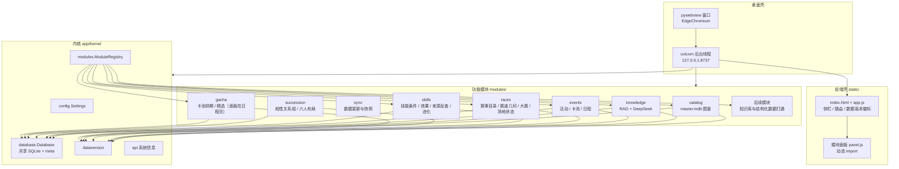
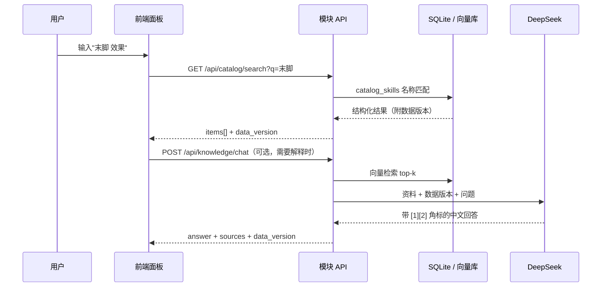

# 架构

## 分层

内核只做四件事：装配（`main.create_app`）、存储（`Database`）、版本（`DataVersion`）、模块生命周期（`ModuleRegistry`）。业务全部在 `modules/` 里，删除任一模块，应用仍能启动。

模块之间不互 import，跨模块展示走 HTTP：`events`（日程总页）的面板会调 `/api/gacha/banners` 与 `/api/races/champions` 渲染卡池与大赛排期，任一接口不可用时那张卡降级成一行提示。`requires` 只用于保证加载顺序，不传递 Python 依赖。

## 启动流程

1. `python -m app.desktop` 探测可用端口（默认 8737，被占用则顺延）。
2. 后台线程启动 uvicorn，加载 `app.main:app`。
3. `create_app()`：建 `Database` → 创建 `ModuleRegistry` → `discover()` 扫 `modules/*/manifest.toml` → `_topological_order()` 按 `requires`/`order` 排序 → 逐个 `setup(ctx)`。
4. 每个成功模块的 `router` 以 `manifest.api.prefix` 挂载；`ui/` 目录挂到 `/module-assets/<id>/`。
5. lifespan 里 `registry.start()`，调用各模块 `on_startup`；退出时反向 `on_shutdown`。
6. 主线程用 `httpx` 轮询 `/api/health`，就绪后开 pywebview 窗口。

任何一步的模块级失败都被限制在该模块内：`LoadedModule.error` 记录原因，`/api/system/modules` 返回 `status: "error"`，前端显示为不可用，而不是白屏。

## 请求与数据流

事实（名称、数值、技能描述）走结构化查询，确定性、可核对；建议（怎么练、怎么配队）走 LLM，但必须附资料与版本。两者在 UI 上分开呈现，避免把模型幻觉当结论。

## 数据版本

- 存储：`data/app.db` 的 `meta` 表，键 `data.version` / `data.game_version` / `data.updated_at` / `data.source` / `data.datasets`。
- 写入：只有导入/同步流程能写，业务代码只读（`read_data_version`）。
- 展示：侧栏徽标、概览页、`/api/system/info`、`ChatResponse.data_version`。
- 未导入时 `known=False`、`version="unknown"`，UI 显示"未导入数据"而不是假装有数据。
- 数据集与游戏版本分开记录：同一版客户端可能对应多次数据修正。

## 存储

| 位置 | 用途 |
| --- | --- |
| `data/app.db` | 共享 SQLite（WAL）；`meta` 表 + 各模块的 `catalog_*` / `events_*` / `races_*` / `skills_*` / `succession_*` / `gacha_*` 等表 |
| `data/modules/<id>/` | 模块私有文件（知识库的 `chroma/`、`documents.json`、`uploads/`；日程与赛道的 `cache/` 抓取缓存等） |
| `data/mdb/master.mdb` | 从设备提取的游戏数据文件留档（`UMA_SYNC_KEEP_MDB=false` 可关） |
| `data/snapshots/<版本>.json` | 每次数据导入的元信息与校验和，用于回答"这版数据从哪来" |
| `data/logs/app.log` | 运行日志，1 MB × 3 份轮转 |
| `data/.tmp/` | 提取/上传的中转目录，用完即删；不写系统临时目录（打包后再统一定位置） |

不用 ORM：表结构与查询都可控，且导入 `master.mdb` 是纯 SQL 搬运，ORM 只会增加映射噪音。

## 前端约定

无构建、无框架：`static/app.js` 负责侧栏 / hash 路由 / 动态 `import()` 面板，面板只拿到 `ctx`（`api` / `escapeHtml` / `toast` / `createLimiter` / `state` / `refreshInfo`）。

界面目标是「一屏能读完，不用滚一屏才看完一个列表」：

| 约定 | 做法 |
| --- | --- |
| 内容限宽 | `#view` 最大 1180px 并居中，宽屏下卡片不会被拉成一整条长框 |
| 卡片网格 | 条目类列表用 `class="list grid"`（`repeat(auto-fill, minmax(300px, 1fr))`），每行 2–3 张，而不是竖着堆 |
| 长列表折叠 | 首屏只渲染 6–9 条，底部「展开其余 N 条 / 收起」；由 `ctx.createLimiter(默认条数)` 管理，key 形如 `gacha:upcoming`、`tl:active`、`skills` |
| 长文本 | 描述类文本加 `class="meta clamp"`（两行截断），完整内容进详情或 `title` |
| 长明细折叠 | 来源清单这类次要信息放进 `
`，默认收起，`summary` 写「展开来源明细（2 条 …）」 |
| 不换行的角标 | 状态 pill、编号、时间加 `nowrap`；网格内的 nowrap 会自动放开，避免撑出横向滚动条 |

校验方式：`document.querySelector(".main-scroll").scrollWidth === clientWidth`（不应出现横向滚动条）。

## 边界与安全

- 只监听 `127.0.0.1`，不对外提供端口；无鉴权（本机单用户）。- 出网仅两处：DeepSeek API、Hugging Face 模型下载、BWiki `api.php`（日程抓取）；都可由环境变量改为本地/镜像。
- 只读游戏文件：`master.mdb` 以 `mode=ro` 打开，绝不写回。
- 不做客户端注入、内存读取、抓包、自动化操作（见 `CONTRIBUTING.md` 第 5 节）。

## 扩展点

| 想加的东西 | 加在哪 |
| --- | --- |
| 新功能 | 新建 `modules/<id>/`，见 [modules.md](modules.md) |
| 新的系统级能力（如全局缓存、日志面板） | `app/kernel/`，通过 `ModuleContext` 暴露 |
| 新的数据源 / 同步 | [data-sync.md](data-sync.md)；已实现的入口在 `modules/sync/` |
| 新的 wiki 来源（活动 / 卡池） | [events.md](events.md)；改 `modules/events/sources.py` 的 `SOURCES` |
| 新的赛道或赛事字段 | [races.md](races.md)；编码表在 `modules/races/sources.py` |
| 新的技能字段或反查路径 | [skills.md](skills.md)；连接键与降级规则在 `modules/skills/importer.py` |
| 相性 / 继承布局相关 | [succession.md](succession.md)；关系组口径在 `modules/succession/service.py` 顶部 docstring |
| 卡池 / 抽卡相关内容 | [gacha.md](gacha.md)；排期与精选在 `modules/gacha/importer.py` |
| UI 结构或主题 | `static/`（外壳），模块只提供面板内容 |
