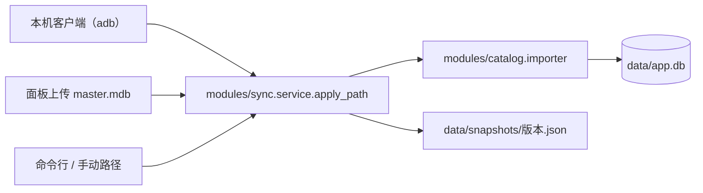

# 数据同步设计

本文档说明「游戏数据怎么进入本地库、怎么判断要不要更新、怎么追溯是哪一版」。
P1 已落地（`modules/sync`），P2–P4 仍是计划。

## 现状：三条入口，一条链路



- `apply_device()`：adb 提取 → 校验 → 落到 `data/mdb/master.mdb` → 导入
- `apply_upload()`：浏览器选文件 → `data/.tmp/` → 导入
- `apply_path()`：CLI 与手动给路径

三条入口最后都走 `apply_path()`，**字段映射只有 `importer.py` 一份**，`scripts/*.py` 全是薄封装。

```powershell
# 命令行
uv run python scripts/import_master_mdb.py "D:\path\master.mdb" --game-version 2.0.2
uv run python scripts/fetch_mdb_android.py --check      # 只看有没有新版本
uv run python scripts/fetch_mdb_android.py              # 提取到 data/mdb/master.mdb
```

界面里对应概览页的「数据版本」卡：检查客户端 → 导入这一版，或直接选文件上传（`manifest.toml` 的 `[ui] hidden = true`，所以模块有面板但不占侧栏）。

## 需求

1. 明确「我现在看到的数据是哪一版」——`data.version` / `game_version` / `updated_at` / `source`。
2. 不要无意义重导：用 sha256 判断「这份文件是否已经在库里」，相同就跳过。
3. 公开给玩家后，不可能让每个人都去找 `master.mdb`：需要一条**不依赖游戏文件**的补数据通道（BWiki / 官方公告），并明确标注来源差异。
4. 断网可用：所有数据落地本地，同步失败只提示，不影响已有数据。

## 数据源分级

| 级别 | 来源 | 可信度 | 用途 |
| --- | --- | --- | --- |
| A | 本机 `master.mdb`（用户自己提供） | 最高，与客户端一致 | 图鉴、技能、协助卡等全部结构化事实 |
| B | BWiki（MediaWiki API） | 高，人工维护 | 活动/卡池/日程等 mdb 里没有的时效性信息 |
| C | 官方公告 HTML | 高，但结构不稳定 | 版本号、维护时间、卡池起止 |
| D | 社区整理（GameTora 等，非简中服） | 中，仅作参考 | 缺数据时的兜底，必须标注"非简中服" |

规则：A > B > C > D，同一字段多源冲突时取高级别，并在 `source` 里记下出处。**D 级数据不得伪装成简中服事实。**

> 社区 `master.mdb` 存档（见 `docs/kb/README.md` 的 S7，`zh-CN` 2023-10-03）**已不再作运行时数据源**：它只用于验证导入器的降级路径（该快照的 `skill_data` 少 16 列）。当前数据来自用户本机客户端的 S10 快照（`mdb-cn-20261022`，游戏 2.0.2，sha256 `e0da18e6b9d1`），由 adb 从模拟器提取，不随仓库分发。
>
> 这意味着「最新」的上限就是**用户客户端实际更新到的那一版**：客户端没更新，本地库也不会凭空变新。同步模块能做的只是把「提取 → 校验 → 导入 → 留档」自动化并比对 sha256，不能替代游戏更新。

## 版本号命名约定

`data.version` 必须能回溯到**数据快照**，而不是导入时间：

- 从客户端提取：默认取设备上 mdb 的修改日期写成 `mdb-cn-<yyyymmdd>`（如 `mdb-cn-20261022`），因为它最接近资源版本日期。
- 导第三方存档：`--data-version mdb-cn-<快照日期>`。
- 只给版本不给日期时回退 `mdb-<game_version>` 或 `mdb-<当天日期>`；后者只代表导入日期，命令行会提示。

导完新快照后需要复核哪些知识库位置、如何记录，见 [kb/README.md 的 3.4](./kb/README.md)。

## 落点

```
data/
├─ app.db                      # 结构化数据（catalog_*）+ meta 数据版本
├─ mdb/master.mdb              # 从设备提取的文件留档（UMA_SYNC_KEEP_MDB 可关）
├─ snapshots/<版本>.json       # 每次导入的元信息 + 校验和（不存游戏资源本体）
├─ .tmp/                       # 提取/上传的中转目录，用完即删（settings.tmp_dir）
└─ logs/app.log                # 导入与提取过程的日志
```

全部落点都在工作区内的 `data/` 下，不写系统临时目录——mdb 有二十几 MB，多数机器 C 盘更紧张。打包成独立程序时再统一改临时/持久化位置，业务代码只需改 `Settings.data_dir`。

快照内容（示例，`data/snapshots/mdb-cn-20261022.json`）：

```json
{
  "version": "mdb-cn-20261022",
  "game_version": "2.0.2",
  "sha256": "e0da18e6b9d1…",
  "source": "master.mdb (sha256:e0da18e6b9d1)",
  "via": "android",
  "datasets": { "characters": 161, "support_cards": 362, "skills": 1289, "text_entries": 61801 },
  "imported_at": "2026-10-26T13:21:38+00:00",
  "device": { "serial": "127.0.0.1:16384", "remote_mtime": "2026-10-22T19:37" }
}
```

`via` 取 `android` / `upload` / `path` / `cli`；`backfilled: true` 表示这条是根据本地库 `meta` 补记的历史（同步模块接入前导入的版本）。

## 已实现的接口

```
GET  /api/sync/status          # 当前版本、sha256、快照数、留档 mdb
GET  /api/sync/history?limit=  # 快照列表（按导入时间倒序）
GET  /api/sync/device          # adb 是否可用（不连设备）
GET  /api/sync/device/check    # 提取+体检，比对 sha256，返回 suggested_version，不写库
POST /api/sync/android         # {serial?, package?, force?} 从设备提取并导入
POST /api/sync/mdb             # {path, game_version?, data_version?, force?} 导入本机文件
POST /api/sync/upload          # multipart：file + game_version? + data_version? + force?
```

尚无（见「分期」）：`POST /api/sync/wiki`、`POST /api/sync/rollback`、差异摘要。

## 关键实现点

- **幂等**：`apply_path()` 先算文件 sha256，与 `meta.data.source` 里的前 12 位比对；一致就返回 `imported: false` 并说明「已是这一版」，不重写库、不新增快照。`force=true` 可强制重导。
- **补记历史**：跳过时若当前版本还没有快照文件，会按 `meta` 补写一条（`backfilled: true`），避免历史里凭空少掉已有数据。
- **版本探测不写库**：`/device/check` 只提取到 `data/.tmp/` 并体检，返回 `is_current` 与 `suggested_version`，由用户决定是否导入。
- **一致性**：写入在 `db.transaction()` 内完成，失败整体回滚，不会出现"版本号变了但数据只写了一半"。
- **设备去重**：同一台模拟器可能同时暴露 `emulator-5554` 与 `127.0.0.1:16384`，用 `ro.build.fingerprint` 去重；多个真实设备时要求显式指定 `--serial`。
- **体检**：文件头必须是 SQLite、必须含 `text_data` / `card_data` / `support_card_data` / `skill_data`，否则拒绝入库并说明缺哪张表。
- **合规**：只读用户本机文件；不下载、不缓存卡面/语音等美术资源；不提供 `master.mdb` 下载。

## 分期

| 阶段 | 内容 | 状态 |
| --- | --- | --- |
| P1 | `modules/sync` + 设备提取 + 上传 + sha256 幂等 + 快照历史；CLI 退为薄封装 | ✅ 已完成 |
| P2 | BWiki 活动/卡池同步 + 差异展示 + 来源角标 | 计划中 |
| P3 | 官方公告解析（版本号、维护、卡池时间） | 计划中 |
| P4 | 快照回滚、增量 diff 审计、多源冲突合并策略 | 计划中 |

## 待定

- 是否给玩家提供「社区数据包」（人工校验过的 JSON），以规避分发游戏资源的问题——需要先确认许可与合规。
- 简中服版本号与日服不对应，`game_version` 必须由用户/公告提供，不能从 mdb 内部推断。
- 知识库模块（RAG）与同步模块的边界：Wiki 原文先进知识库还是先结构化？倾向「能结构化就进 catalog，纯文本进 knowledge」，避免同一份事实两处维护。
- 回滚不只是换一个快照文件：需要保留旧 `app.db` 或拥有可重放的 mdb，才能真的退回去。
