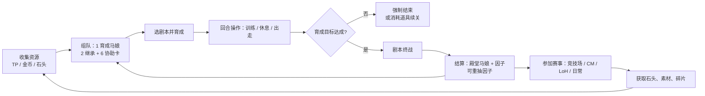

# 游戏概览：形态、卡片与核心循环

> **来源**：S1 日文维基百科「ウマ娘 プリティーダービー」ゲームシステム节；S2 官方站游戏系统页
> **来源版本**：S1 revid 111448118（2026-10-20T05:06:50Z）；S2 抓取于 2026-10-25
> **抓取时间**：2026-10-25
> **可信级别**：B（机制骨架），A（官方口径的玩法定位）
> **适用版本**：日服内容口径，截至 2026 年 7 月；剧本与卡池进度与简中服不同步
> **已知缺口**：本章不含任何数值；简中服译名见 [08-glossary.md](./08-glossary.md)

## 游戏是什么

《闪耀！优俊少女》是 Cygames 的赛马娘企划（ウマ娘 プリティーダービー）的手游。玩家扮演训练员，把以真实日本赛马为原型的「马娘」培养成赛道上的选手。

各语言版本的上线时间（来源 S1「リリース」节）：

| 版本 | 上线时间 |
| --- | --- |
| 日服 | 2021-02-24 |
| 韩服 | 2022-06-20 |
| 繁体中文版（台港澳，Komoe Game 代理） | 2022-06-27 |
| 简体中文版（bilibili 运营，即《闪耀！优俊少女》） | 2023-08-30 |

简中服比日服晚约两年半，因此**版本进度、卡池、剧本都不与日服同步**。

游戏不是纯粹的角色对战，而是「养成 + 赛马」两层结构：先在育成模式里用有限回合把一名马娘练出来，再用练成的马娘去参加各种赛事玩法（PVP、活动、日常）。

## 两类卡片

游戏里的「马娘」分成用途完全不同的两类，这是新手最容易混淆的地方。

### 育成马娘（育てる対象）

- 通过「プリティーダービー扭蛋」获得，是育成的**对象**。
- 稀有度按星级分 3 档：★1 / ★2 / ★3。
- 星级可以通过「才能开花」提升，上限为 ★5。
- ★3 以上的育成马娘才有角色专属的胜负服；★1 / ★2 初始使用通用胜负服，开花到 ★3 后可获得专属胜负服。
- 育成结束后成为「殿堂入り」马娘（可理解为成品存档），可以反复育成同一角色而不会消失。

### 协助卡（サポートカード）

- 通过「协助卡扭蛋」获得，育成时用来**辅助**育成马娘。
- 稀有度分 R / SR / SSR 三档。
- 按类型分 7 种：速度（スピード）、耐力（スタミナ）、力量（パワー）、毅力（根性）、智力（賢さ）、友人、组队（グループ）。
- 效果主要是提升对应属性的成长幅度、提供技能提示、触发事件。
- 每张协助卡有「友情槽（絆ゲージ）」，同训练累积后上升；槽达到一定量后可能触发「友情训练（友情トレーニング）」，一次性大幅提升对应属性。
- 组队卡包含多名马娘，规则上「同一张卡不得重复装备」的判定会覆盖卡内所有马娘。

> 协助卡里也有非马娘角色（例如教练、其他人物），这类卡官方称为「サポートキャラ」。

## 育成与养成上限

育成是「一次性」的：选定剧本 → 选 1 名育成马娘 + 2 名继承马娘 + 6 张协助卡 → 在固定回合数内把属性练起来 → 打完剧本终战 → 结算成殿堂马娘并产生因子。

育成过程中获得的一切（属性、技能、因子）都固化在那一次的成品上，之后再强化卡片**不会**追溯修改已经练成的殿堂马娘。这一点决定了玩家的核心循环：环境变化 → 重新育成。

详细的回合结构、目标、剧本见 [02-career.md](./02-career.md)。

## 核心循环

## 名词体系的三层

同一件事在游戏里有三套叫法，做助手时必须能互相映射：

| 层 | 例 | 说明 |
| --- | --- | --- |
| 日文原文 | スピード、やる気、覚醒Lv | 数据表（`master.mdb`）、社区 wiki、本知识库的主键 |
| 英文（国际服） | Speed、Mood、Awakening Level | 国际服 UI 与英文攻略站用 |
| 简中（简中服） | 速度、干劲、觉醒等级 | 取自简中服 `master.mdb` 文本表，见 [08-glossary.md](./08-glossary.md) |

助手内部以日文原文为主键、中文为展示层，理由是：`master.mdb` 的结构化数据、开源的社区工具、以及绝大多数可核实的攻略资料都以日文原名为准。

## 与其他模块的关系

- 卡牌/技能的具体数值来自 `catalog` 模块（需要真实 `master.mdb`），本知识库只解释机制。
- 「简中服现在是什么版本」属于时效性信息，由用户在界面上标注，对应 README 里的数据版本机制。
