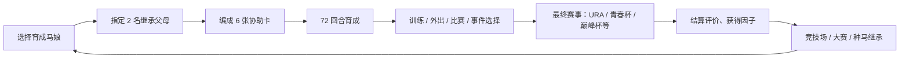
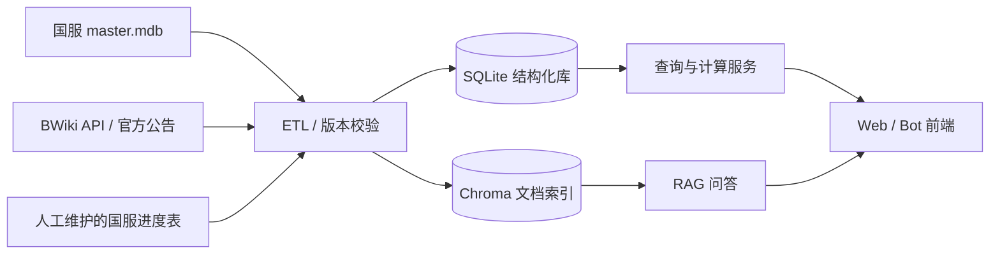

# 《闪耀！优俊少女》助手 · 前置调研

> 调研时间：2026-10-25
> 范围：游戏机制、简中服（B 服）现状、可用数据源、开源项目、技术依赖
> 结论先行：**数据应以"国服本地 `master.mdb` 为主、BWiki 为补、日服资料为参考"**；不建议把自动化脚本或客户端注入作为核心依赖。

---

## 1. 游戏本体速览

《赛马娘 Pretty Derby》是 Cygames 的跨媒体企划，把日本真实赛马拟人化为"马娘"，核心是"育成 + 比赛"的手游。玩家扮演训练员，在三年 72 个回合内培养马娘，最终挑战各剧本的决赛，并把育成结果用于竞技场、大赛和种马继承。国服由 bilibili 代理，译名为《闪耀！优俊少女》。

### 1.1 各服基本事实

| 项目 | 日服 | 简中服（B 服） | 繁中服 | 国际服 |
|---|---|---|---|---|
| 名称 | ウマ娘 プリティーダービー | 闪耀！优俊少女 | 賽馬娘 Pretty Derby | Umamusume: Pretty Derby |
| 运营 | Cygames | bilibili | Komoe Game | Cygames |
| 上线 | 2021-02-24（手机）/ 2021-03-10（DMM PC） | 2023-08-30 公测（2023-03-20 获版号） | 2022-06-27 | 2025 年（具体日期待核实） |
| 客户端包名 | `jp.co.cygames.umamusume` | `com.bilibili.umamusu`（腾讯渠道 `com.tencent.tmgp.bilibili.umamusu`） | `com.komoe.kmumamusumegp` 等 | `com.cygames.umamusume` |
| 数据语言 | 日文 | **简体中文** | 繁体中文 | 英文 |

> 包名来源：`Kimjio/umamusume-localify` 的 `src/game.hpp` 常量表，非官方文档。

国服内容明显滞后于日服：BWiki 简中服协助卡节奏榜在 2025-09 标注的数据版本为 **Ver.1.15.5**，同月仍在更新"新马评测"。**2026 年的最新进度未在公开资料中确认，项目启动时必须以国服游戏内公告和本地 `master.mdb` 版本为准。**

### 1.2 核心玩法循环



### 1.3 与助手相关的系统模块

| 模块 | 关键概念 | 助手可做什么 |
|---|---|---|
| 育成 | 5 属性（速度/耐力/力量/毅力/智力）、体力、心情、羁绊、回合数 | 目标属性规划、训练优先级、体力/心情管理建议 |
| 协助卡 | 6 张编成、突破等级、事件、金技能 | 卡池强度排序、编成推荐、平替方案 |
| 继承 | 父母 + 祖父母、相性、属性/技能/适应性因子 | 相性计算、种马筛选、因子目标 |
| 技能 | 技能点、觉醒、进化、条件与效果 | 技能收益估算、点数分配、赛道适配 |
| 赛事 | 场地/距离/跑法适应性、赛道、天气/马场 | 赛道模拟、技能触发率、配队 |
| 竞技场 | Team Stadium、队伍评分 | 队伍评分优化、出场顺序 |
| 大赛 | Champions Meeting、轮次、赛道条件 | 大赛环境分析、参赛马与配卡 |
| 活动 | 剧情活动、任务、兑换、限时卡池 | 活动日历、收益/兑换优先级 |
| 抽卡 | 卡池排期、天井、付费/免费 | 抽卡规划、保底计算、性价比 |

> 国服译名体系与民间叫法差异较大（游戏名本身就把"马娘"改为"优俊少女"），**别名映射表是刚需**，否则用户问"速子""帝宝""麦昆"时检索会失败。

---

## 2. 简中服的特殊性（决定了技术选型）

1. **版本滞后**：卡池、剧本、活动排期与日服不同，不能直接套用日服节奏。
2. **译名独有**：国服有官方简中译名，与日文原名、繁中译名、民间俗称并存。
3. **数据不公开**：社区维护的 `master.mdb` 存档（如 `ChihyuenWang/Umamusume-MasterMDB`）只覆盖 `ja-JP` 和 `zh-TW`，**没有公开的简中版**。国服数据只能从本地客户端提取，或从 BWiki/公告人工维护。
4. **合规敏感**：B 站代理，客户端有完整性校验；修改客户端、注入、自动化操作都有账号风险。

---

## 3. 数据源清单

### 3.1 客户端数据库 `master.mdb`（最权威）

- 本质是 SQLite，日服 DMM 版路径为 `<游戏目录>/master/master.mdb`；Android 版通常位于游戏私有目录的 `files/master/master.mdb`（需 root 或模拟器访问）。
- 社区脚本 `UmaMusumeAPI` 的建表脚本共 **498 张唯一表**，可直接作为 schema 参考。
- 国服 `master.mdb` 内含简体中文文本，是**唯一可靠的国服数据源**。

核心表（已确认存在）：

| 表 | 内容 |
|---|---|
| `text_data` | 本地化文本（含简中），国服译名的直接来源 |
| `chara_data` | 马娘基础数据 |
| `support_card_data` / `support_card_effect_table` / `support_card_unique_effect` | 协助卡与效果 |
| `skill_data` / `skill_exp` / `skill_level_value` / `skill_set` | 技能基础、升级消耗、技能组 |
| `skill_upgrade_condition` / `skill_upgrade_description` / `skill_upgrade_speciality` | 技能进化条件与描述 |
| `race_course_set` / `race_instance` / `race_track` | 赛道、比赛实例、场地 |
| `race_proper_distance_rate` / `race_proper_ground_rate` / `race_proper_runningstyle_rate` | 适应性系数 |
| `single_mode_scenario` / `single_mode_route` / `single_mode_program` | 剧本、目标、赛程 |
| `single_mode_training` / `single_mode_training_effect` | 训练参数 |
| `single_mode_event_production` / `single_mode_event_conclusion` | 育成事件与选项结果 |
| `succession_factor` / `succession_factor_effect` / `succession_relation` / `succession_rental` | 因子、相性、租借种马 |
| `champions_*` | 大赛轮次、赛道条件、奖励 |
| `gacha_data` / `gacha_available` | 卡池与开放状态 |
| `item_data` / `mission_data` | 道具、任务 |

**提取与更新流程（建议）**：

```text
国服客户端更新
  → 取出 master.mdb（模拟器 / root / 官方包解包，按实际情况选择）
  → 校验版本（meta/版本表）与表完整性
  → ETL 导入本地 SQLite（只读快照 + 派生表）
  → 生成别名/检索用的 JSON 快照
  → 重建 RAG 索引
```

**风险提示**：解包/读取本地文件属于个人研究行为，不要分发数据库文件或其中的游戏文本；不要修改客户端。

### 3.2 社区 Wiki / 网站

| 来源 | 语言 | 覆盖 | 访问方式 | 备注 |
|---|---|---|---|---|
| [BWiki 赛马娘](https://wiki.biligame.com/umamusume/) | 简中 | 日服 + 简中服攻略/节奏榜/种马库 | **MediaWiki API 可用**：`api.php?action=query` 或 `action=parse`，输出 JSON | 有速率限制（实测会返回 567），需限速+缓存；内容版权归权利方 |
| [GameTora](https://gametora.com/umamusume) | 英/日/韩/繁中界面 | 日服数据库、赛道、技能 | 网页（Next.js），无公开 API 文档 | 数据以日服为主；有 Patreon，使用需遵守其条款 |
| [uma.moe](https://uma.moe/) | 英文 | 国际服：种马工作区、赛事分析、时间线 | 网页 + 社区 API（第三方 bot 在用） | 站点稳定性一般（调研时首页报错） |
| [umapyoi.net](https://umapyoi.net/) | 英文 | 日服角色、声优、新闻 | 公开 REST API | 作者 KevinVG207，**要求署名** |
| [Urarawin](https://urarawin.com/) | 简中 | 工具站（相性、赛道等，SPA） | 网页 | 无公开 API 文档，抓取需谨慎 |
| Game8 / Altema | 日文 | 日服攻略、节奏榜 | 网页 | 适合做 RAG 语料，注意版权 |
| NGA / 贴吧 / B 站专栏 | 简中 | 国服环境、卡池、心得 | 反爬较强 | 只做人工参考，不建议批量抓取 |

### 3.3 社区 API / 数据集

| 名称 | 内容 | 许可/状态 |
|---|---|---|
| [SimpleSandman/UmaMusumeAPI](https://github.com/SimpleSandman/UmaMusumeAPI) | `master.mdb` → REST，含相性/推荐存储过程 | Apache-2.0，**2025-10-29 已退役**，仅作 schema 参考 |
| [SimpleSandman/UmaMusumeMetaMasterMDB](https://github.com/SimpleSandman/UmaMusumeMetaMasterMDB) | 日服 `master.mdb` 公开存档 | 已归档 |
| [ChihyuenWang/Umamusume-MasterMDB](https://github.com/ChihyuenWang/Umamusume-MasterMDB) | 跟踪 `ja-JP` / `zh-TW` 的 `master.mdb` 与文本 | 活跃度一般 |
| [azmiao/uma_info_data](https://github.com/azmiao/uma_info_data) | 中文基础数据（`config_v2.json` 约 1.1MB）+ 语音 | **GPL-3.0**，自动更新 |
| [alpha123/uma-skill-tools](https://github.com/alpha123/uma-skill-tools) `data/` | `skill_data.json`、`course_data.json`、`skillnames.json` | **GPL-3.0** |
| [rockisch/umadump](https://github.com/rockisch/umadump) | 导出玩家种马列表 JSON（读游戏内存） | 无明确许可，谨慎使用 |
| uma.moe API | 公会/种马数据 | 非公开文档，需遵守站点条款 |

### 3.4 官方信息源

- 游戏内公告（最准，优先）
- 国服官网 / B 站游戏中心动态
- 官方微博、B 站账号
- 版本更新公告（含卡池、活动、维护补偿）

---

## 4. 开源项目清单

### 4.1 数据 / 解析

| 项目 | 语言 | Star | 许可 | 状态 | 用途 | 建议 |
|---|---|---|---|---|---|---|
| `SimpleSandman/UmaMusumeAPI` | C# | 36 | Apache-2.0 | 已归档 | 表结构、相性算法参考 | **参考 schema** |
| `SimpleSandman/UmaMusumeLoadSqlData` | C# | 6 | Apache-2.0 | 已归档 | mdb → MariaDB | 参考 ETL |
| `FabulousCupcake/umamusume-db-translate` | Shell | 50 | 未核实 | 已归档 | 补丁式翻译 `master.mdb` | 参考文本结构 |
| `MarshmallowAndroid/UmamusumeExplorer` | C# | 188 | 未核实 | 活跃 | 查看游戏资源 | 资源研究 |
| `ChihyuenWang/Umamusume-MasterMDB` | — | 3 | 未核实 | 一般 | mdb 版本跟踪 | 参考更新流程 |

### 4.2 模拟 / 计算

| 项目 | 语言 | Star | 许可 | 状态 | 用途 | 建议 |
|---|---|---|---|---|---|---|
| `alpha123/uma-skill-tools` | TypeScript | 71 | **GPL-3.0** | 活跃 | 单马赛事模拟、技能触发/收益 | 可独立进程调用；集成需 GPL 兼容 |
| `hzyhhzy/UmaAi` | C++ | 182 | 未核实 | 活跃 | 完整场景/比赛模拟 | 研究数值模型 |
| 相性/耐力计算器 | 多 | — | — | — | `uma_plugin`、BWiki、Urarawin 均有实现 | 自行实现或参考公式 |

### 4.3 本地化 / 客户端插件（高风险）

| 项目 | 语言 | Star | 说明 |
|---|---|---|---|
| `MinamiChiwa/Trainers-Legend-G` | C++ | 640 | PC 客户端本地化注入 |
| `GEEKiDoS/umamusume-localify` | C++ | 241 | DMM 客户端本地化（已归档） |
| `Kimjio/umamusume-localify` | C++ | 110 | Windows 本地化/增强 |
| Hachimi（`noccu`） | — | — | 移动端翻译插件生态 |

> 这类项目通过注入/补丁修改客户端，**本项目不采用**，仅用于了解文本与资源结构。

### 4.4 自动化 / 抓包（不采用）

| 项目 | 语言 | Star | 说明 |
|---|---|---|---|
| `NateScarlet/auto-derby` | Python | 466 | 自动育成（已归档） |
| `shiokaze/UmamusumeAutoTrainer` | Python | 325 | 明确面向国服的自动育成 |
| `steve1316/uma-android-automation` | Kotlin | 159 | 安卓自动化 |
| `Remezzo/Umamusume-Icarus` | — | 52 | 直连游戏服务器 |
| `UmamusumeResponseAnalyzer` | C# | 199 | 通过 Hachimi-Edge 转发请求/响应做实时分析 |

> 上述方案要么修改客户端、要么自动化操作、要么直连服务器，均违反用户协议且有封号风险。**本项目明确排除**，也不将其作为数据管线的一环。

### 4.5 社区机器人（功能参考）

| 项目 | 语言 | Star | 许可 | 说明 |
|---|---|---|---|---|
| `azmiao/uma_plugin` | Python | 129 | **GPL-3.0** | HoshinoBot 插件：新闻、模拟抽卡、查询、节奏榜、相性、耐力计算、技能查询、育成目标 |
| `Hachimi-Hachimi/PakaNews` | TypeScript | 2 | 未核实 | 基于 umapyoi.net API 的新闻页 |

`uma_plugin` 是最接近"助手"形态的中文参考实现，其数据抓取源（官网、BWiki、`uma_info_data`）值得借鉴；但它是 GPL-3.0，**只读代码、不复制代码**。

---

## 5. 助手能力地图（需求承接表）

| # | 能力 | 依赖数据 | 实现方式 | 难度 | 建议优先级 |
|---|---|---|---|---|---|
| 1 | 马娘/协助卡/技能查询 | `chara_data`、`support_card_data`、`skill_data` | SQLite 精确查询 + 别名模糊匹配 | 低 | P0 |
| 2 | 国服卡池/活动日历 | 官方公告、BWiki | 定时抓取 + 人工校正 | 中 | P0 |
| 3 | 攻略问答（RAG） | 攻略文档、公告、Wiki 页面 | 复用现有 `rag-service`（Chroma + DeepSeek） | 低 | P0 |
| 4 | 协助卡强度/编成建议 | 节奏榜、卡池、育成目标 | 规则 + 检索 + LLM 组织 | 中 | P1 |
| 5 | 相性计算 / 种马筛选 | `succession_*`、玩家种马数据 | 纯计算，不依赖 LLM | 中 | P1 |
| 6 | 技能收益 / 赛道模拟 | 技能条件、赛道数据 | 移植或调用 `uma-skill-tools` 模型 | 高 | P2 |
| 7 | 育成规划（属性/回合） | 训练参数、事件、目标 | 规则引擎 + 模拟 | 高 | **不做**：缺训练收益与事件结果两类表，结论无法验证 |
| 8 | 大赛环境分析 | 大赛赛道、使用率数据 | 数据统计 + 检索 | 中 | P1（赛制与赛道来自 mdb 的 `champions_*`；使用率仍需外部统计） |
| 9 | 抽卡规划/保底计算 | 卡池、天井规则 | 纯计算 | 低 | P1 |
| 10 | 截图 OCR 识别 | 截图 | 本地 OCR（可选，不读内存） | 中 | P3 |

> P0 可在不解析 `master.mdb` 的情况下先用"BWiki + 人工维护表"跑通；P1/P2 再引入本地数据库和模拟器。

---

## 6. 技术选型与依赖清单

### 6.1 总体架构



### 6.2 复用现有 `rag-service`

现有 [rag-service](../../rag-service/README.md) 已具备：

- FastAPI + 网页前端
- PDF/Markdown/TXT → 切块 → `BAAI/bge-small-zh-v1.5` → Chroma
- DeepSeek 问答与引用
- 文档增删/检索接口

**结论**：问答侧直接复用；新增的是"结构化数据层"和"计算工具层"，不要让 RAG 承担精确数值查询（它不可靠）。

### 6.3 Python 依赖

已在 `rag-service` 中（可直接复用）：

| 包 | 用途 |
|---|---|
| `fastapi` / `uvicorn[standard]` | HTTP 服务 |
| `pydantic-settings` | 配置 |
| `python-multipart` | 文件上传 |
| `pypdf` | PDF 解析 |
| `chromadb` | 向量库 |
| `sentence-transformers` | 本地 embedding |
| `openai` | DeepSeek 兼容客户端 |
| `pytest` / `httpx` / `ruff` | 开发 |

建议新增：

| 包 | 用途 | 备注 |
|---|---|---|
| `httpx` | 抓取 BWiki / 公告 | 已有 dev 依赖，提为运行时 |
| `beautifulsoup4` + `lxml` | 解析 HTML / MediaWiki 输出 | 轻量 |
| `tenacity` | 重试与退避 | 配合 BWiki 限速 |
| `apscheduler` | 定时更新数据/公告 | 也可用系统计划任务 |
| `jieba` | 中文分词（检索增强） | 可选 |
| `rapidfuzz` | 别名/卡名模糊匹配 | 强烈建议 |
| `pandas` | ETL 与统计 | 可选，纯 `sqlite3` 也能做 |
| `sqlalchemy` | ORM | 可选；本项目倾向 `sqlite3` + 手写 SQL |

不建议引入：Scrapy（过重）、Playwright（BWiki 有 API、GameTora 有静态 HTML，非必需）。

### 6.4 运行时与工具链

- Python 3.13（与工作区现有项目一致）
- `uv` 管理依赖与虚拟环境
- SQLite（内置，启用 FTS5 做全文检索）
- Chroma（已有）
- DeepSeek API（已有）
- Node.js **仅在**需要运行 `uma-skill-tools` 时作为可选外部依赖

### 6.5 更新策略

| 数据 | 频率 | 方式 |
|---|---|---|
| 官方公告 / 卡池 | 每日 | 定时抓取 + 变更检测 |
| BWiki 攻略/节奏榜 | 每周 | API 拉取，落快照 |
| `master.mdb` | 每次国服大版本 | 手动触发 ETL |
| 别名表 | 按需 | 人工维护 + 用户反馈 |

---

## 7. 数据模型草案

以本地 SQLite 为主库，`master.mdb` 作为只读源库附加（`ATTACH DATABASE`），派生表如下：

| 表 | 主键 | 说明 |
|---|---|---|
| `characters` | `chara_id` | 马娘、星级、适应性、成长率 |
| `support_cards` | `support_card_id` | 类型、稀有度、技能、事件 |
| `skills` | `skill_id` | 名称、消耗、条件、效果、进化链 |
| `races` / `courses` | `race_id` / `course_id` | 赛道参数、距离/场地/跑法 |
| `scenario_events` | `(scenario_id, event_id)` | 事件选项与结果 |
| `banners` | `banner_id` | 卡池起止、UP 内容、天井 |
| `aliases` | `(entity_type, alias)` | 国服译名/日文名/俗称映射 |
| `documents` | `doc_id` | RAG 文档元数据 |
| `doc_chunks` | `(doc_id, chunk_index)` | 切块与向量引用 |
| `sync_log` | `id` | 数据版本、抓取时间、来源 |

`aliases` 是国服助手的关键表，建议初始数据从 `text_data`（官方简中）和 `uma_plugin` 的 `replace_dict.json`（民间俗称，GPL-3.0，需注意许可）人工整理。

---

## 8. 合规与风险

**本项目采用的红线**：

1. 不修改客户端、不注入、不抓包、不自动化操作游戏。
2. 不读取游戏内存，不触碰账号凭证。
3. 不分发 `master.mdb`、游戏文本、图片、语音等受版权保护的资源。
4. 抓取第三方站点时遵守 `robots.txt` 与速率限制，只缓存必要片段。
5. LLM 回答标注信息来源；数值类结论必须来自本地数据或计算，不靠模型编造。

**需要接受的风险**：

- 从本地客户端提取 `master.mdb` 可能违反用户协议（个人研究用途风险较低，但不为零）。
- BWiki/GameTora 的条款可能限制批量抓取。
- GPL-3.0 项目（`uma-skill-tools`、`uma_plugin`、`uma_info_data`）若被集成，会传染项目许可。

---

## 9. 需求传递模板

后续提需求时，建议按以下格式，能直接映射到本文档的能力编号：

```text
【目标】一句话说明要解决什么问题
【用户】只有自己 / 小圈子 / 公开
【形态】Web / 桌面 / QQ 机器人 / CLI
【能力编号】对应第 5 节，如 P0-1、P1-5
【数据前提】是否接受解析本地 master.mdb；是否接受人工维护表
【输入输出】用户输入什么，期望看到什么
【验收标准】可验证的例子
【优先级】P0 / P1 / P2
```

### 待确认的关键决策

1. **形态**：网页、桌面应用、QQ/微信群机器人，还是先在 CLI 验证？
2. **数据深度**：是否愿意提供/解析国服 `master.mdb`？这决定能否做精确查询与计算。
3. **LLM 边界**：哪些回答允许生成（攻略建议），哪些必须查表（数值、卡池时间）？
4. **实时性**：卡池/活动信息是每日同步即可，还是需要准实时？
5. **目标用户**：只服务自己（可硬编码偏好），还是要给别人用（需要配置与容错）？
6. **许可**：项目是否开源？若开源，需避开 GPL 代码/数据的直接复制。

---

## 10. 参考链接

- BWiki 赛马娘：https://wiki.biligame.com/umamusume/
- GameTora：https://gametora.com/umamusume
- uma.moe：https://uma.moe/
- umapyoi.net：https://umapyoi.net/
- Urarawin：https://urarawin.com/
- UmaMusumeAPI：https://github.com/SimpleSandman/UmaMusumeAPI
- uma-skill-tools：https://github.com/alpha123/uma-skill-tools
- uma_plugin：https://github.com/azmiao/uma_plugin
- uma_info_data：https://github.com/azmiao/uma_info_data
- Umamusume-MasterMDB：https://github.com/ChihyuenWang/Umamusume-MasterMDB
- umadump：https://github.com/rockisch/umadump
- 现有 RAG 服务：[rag-service](../../rag-service/README.md)
